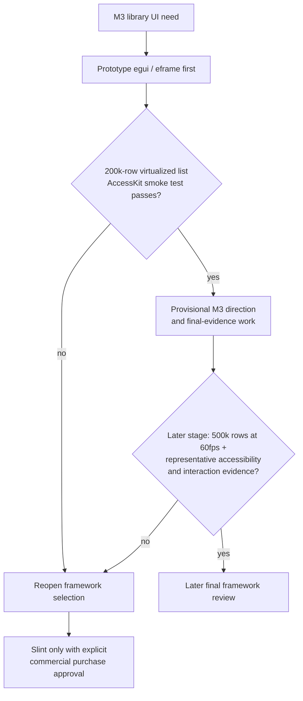

# ADR-001: GUI Framework

> **Accepted (2026-10-15) — prototype direction, not final framework commitment.** The independent Sol review (low effort) is complete and the final ruling is ACCEPT. egui/eframe is the prototype-first direction; Slint is retained only as a commercially licensed fallback; Qt is deferred on Rust-binding API-stability grounds. This does **not** commit to a production framework: the 200k-row virtualized-list + AccessKit smoke test is the current prototype gate. The 500k-row 60fps qualification is deferred to a later final-framework stage, alongside representative accessibility and interaction evidence. Do not add a GUI dependency to the M0 workspace.

## Owner decision (2026-10-24): defer 60fps qualification

The owner deferred the 60fps performance gate from the current isolated-probe stage to a later stage. For current-stage planning, assume the target is achievable; this is **not measured evidence, a pass, or production qualification**. Preserve the 500k-row 60fps target as a gate for the later final-framework review. Current probe evidence must report actual measurements and label this qualification deferred/unverified. Accessibility, interaction, platform, and 200k-row prototype gates remain in force.

## Context

OxiDJ needs a cross-platform Rust desktop GUI for M3 (Usable library UI) onward. The library view must render 100k–500k tracks with smooth scrolling. Accessibility (AccessKit) is a hard requirement for a public DJ app. This decision selects the prototype direction for M3; the final framework commitment is gated on prototype results.

## Decision

Adopt a **prototype-first, evaluate-second** path:

1. **Prototype candidate one:** `egui` / `eframe` — immediate mode gives natural virtualization for dense track lists with the least implementation effort. AccessKit is available as a **default, disableable** feature (see claim-audit correction below).
2. **Evaluate candidate two (commercially licensed fallback only):** `Slint` — declarative DSL with built-in `ListView` virtualization and AccessKit by default. **Not available at the free tier under the MIT licence resolution (ADR-009)**; retained only as a fallback conditional on explicit commercial purchase approval.
3. **Defer:** Tauri 2 (unless a web-tech team is available; adds IPC complexity), iced (no stable AccessKit — disqualified if a11y is hard requirement), GPUI (0 releases in 8.5+ months), Xilem (zero production users).

No framework is committed as the final choice in M0. The current prototype gate is a 200k-row virtualized list with an AccessKit smoke test. The later final-framework stage retains the 500k-row 60fps target plus representative screen-reader, keyboard multi-selection and drag-and-drop evidence. The owner deferred 60fps qualification from the current probe stage; the planning assumption is not evidence of a pass.

The diagram summarizes the accepted M3 prototype direction and the separate evidence gates; it does not imply that the prototype has run or that a production framework is selected.

## Evidence

- `gui-evaluation.md` lines 27-34 (framework landscape table) and line 49 (egui "100K records without any visible performance delay" benchmark): egui (immediate, AccessKit 0.35+, natural virtualization), Slint (declarative, built-in ListView, AccessKit default), iced (no stable AccessKit, no built-in virtualization, "frames dropped, sluggish at 100k"), GPUI (0 releases in 8.5 months), Xilem (zero production users).
- `gui-evaluation.md` lines 64-84: AccessKit is the de-facto shared a11y layer; egui has gaps but is usable; Slint/Tauri/GPUI/Xilem have working integration; iced's a11y issue #552 open since 2020.
- `gui-evaluation.md` lines 49-55: egui immediate mode virtualizes naturally; iced requires custom virtualization work.
- `soundcraft.md` line 56 (ADOPT: "Keep UI dependencies out of the library/domain and adapters") and line 70 (REJECT: "Incumbent-menu parity counts as OxiDJ acceptance"); egui was used in SoundCraft's `ui-egui` crate but this is a research observation, not a port.
- `gui-evaluation.md` lines 126-131: "Prototype in egui" is the research recommendation; "evaluate Slint" is the alternative; "defer Tauri unless team has web expertise."

## Options Considered

| Option | Status | Reason |
|--------|--------|--------|
| egui/eframe prototype first | **Prototype candidate 1** | Fastest iteration, natural virtualization, AccessKit mandatory |
| Slint | **Commercial fallback only** | Not free-tier under MIT (ADR-009); requires purchase approval |
| Tauri 2 | Deferred | Web-tech team availability, IPC complexity |
| iced | Rejected | No stable a11y (6+ years), no built-in virtualization |
| GPUI | Deferred | 0 releases in 8.5 months |
| Xilem | Deferred | Zero production users |

## Consequences

- If egui prototype passes the 200k-row + a11y smoke test, it becomes the provisional M3 framework choice (final review).
- The 500k-row 60fps qualification is deferred to a later stage; no current-stage assumption or measurement is a pass. If egui fails later a11y or performance gates, Slint is the fallback — **only with explicit commercial purchase approval**, since it is excluded at the free tier under ADR-009.
- No final dependency is added to the M0 workspace; the prototype lives in a scratch crate.
- egui's actual a11y gaps (live regions #2647, `labelled_by` panics #3647) become open risks to document.

## Open Questions / What Would Change This

- Does egui's AccessKit integration expose enough semantics for NVDA/VoiceOver/Orca on all three platforms? (Requires real screen-reader testing.)
- Does iced ship stable AccessKit before M3? (Currently blocked since 2020.)
- Would a web-tech team make Tauri the better choice? (Decision gate: team composition by M3.)
- Linux Wayland + NVIDIA WebKitGTK bugs affecting Tauri — does this impact egui/Slint similarly?

## Sol Review Packet

> **Review status: COMPLETED 2026-10-15 (gpt-6.1-sol, reasoning low). Final ruling: ACCEPT** (prototype direction). The review gate is satisfied; the recommendation is accepted as the prototype direction, with the final framework commitment still gated on prototype evidence.

**DECISION:** Prototype in egui first for M3 library UI; evaluate Slint as alternative; defer Tauri (unless web-tech team), iced (a11y gap), GPUI (stalled), Xilem (no production users). Final framework commitment gated on 200k-row virtualized list + a11y smoke-test results.

**WHY NOW:** M3 requires a GUI. Delaying the prototype past early M3 risks rework if virtualization or a11y fails at scale. The research evaluation (gui-evaluation.md) provides the evidence base.

**CONSTRAINTS:** Must support 100k–500k track virtualization; the 60fps target is retained for later final-framework qualification, not this probe stage. Must integrate AccessKit for cross-platform a11y. Must work on Linux (primary), macOS, Windows. No framework may become a hard dependency until prototype validates it. No M5 or realtime-audio GUI in M0.

**OPTIONS:** (1) egui/eframe — prototype candidate 1; (2) Slint — evaluate candidate 2; (3) Tauri 2 — defer unless web team; (4) iced — rejected (no stable a11y); (5) GPUI/Xilem — defer (stalled / no production users).

**EVIDENCE:** gui-evaluation.md: virtualization benchmarks (egui 100k smooth, iced 100k sluggish), AccessKit status table (egui mandatory 0.35+, Slint default, iced missing since 2020), maintenance-risk signals (notgull burnout, GPUI 8.5mo no release, Xilem zero production users). soundcraft.md: ADOPT layer separation, REJECT menu parity.

**CURRENT RECOMMENDATION:** Prototype egui first; evaluate Slint. Confidence: medium (prototype gate remaining). What changes it: egui a11y smoke-test failure, inability to render the 200k-row prototype, or iced shipping stable AccessKit before M3. The 500k-row 60fps result is reserved for later final-framework qualification.

**OUTPUT CONTRACT:** A scratch crate `prototypes/oxidj-gui-probe` that builds on Linux/macOS/Windows, renders 200k synthetic tracks in a virtualized list, runs an AccessKit tree smoke test. Produce a short report: build/test commands, frame-rate measurement, a11y tree status. No dependency enters `Cargo.toml` at workspace root — this is a throwaway probe.

## Independent Review Outcome (2026-10-15)

**Reviewer:** `gpt-6.1-sol` via `openai-codex`, reasoning **low**, isolated delegate (no tools, no delegation, this decision only).

**Recommendation returned:** **egui/eframe, prototype first.** Compare it against Slint before committing, and commit now only to a **UI-independent, command-first application layer**. Confidence: **medium**.

**Reasons accepted:**

- egui is the strongest first candidate on Rust-native development, virtualized rendering and permissive licensing — but **virtualization alone does not establish 60fps with OxiDJ's actual workload.**
- **Accessibility is the gating risk.** Mandatory AccessKit integration does not prove usable screen-reader navigation, focus management, or accessible table semantics. This is the requirement most likely to overturn the choice.
- Slint is a serious challenger and may be the better-balanced choice if its accessibility and keyboard interaction prove better in practice. The evidence does not establish a winner across all requirements.
- **Qt: defer, not disqualify.** Qt's maturity does not transfer automatically to `cxx-qt`. On the evidence, `cxx-qt` is an actively maintained candidate but not a proven stable Rust integration; API churn warrants deferral, and the Qt Bridges uncertainty is an additional risk rather than a permanent veto.
- **Slint's GPL/commercial terms are a conditional constraint, not a veto.** They become decisive only if *both* GPL-compatible distribution and commercial licensing are unacceptable for OxiDJ.

**Counterargument recorded:** egui may turn the central library table into substantial custom interaction and accessibility work. If accessibility is non-negotiable, choosing egui primarily for rendering simplicity could optimise the wrong problem — Slint, or Qt with an accepted binding-maintenance cost, could be the better foundation.

**Consequence:** the prototype gate stands, but it is **not a scrolling benchmark**. Committing to egui requires the same interaction and accessibility checks that would justify Slint: screen-reader table navigation, keyboard multi-selection, and drag-and-drop. The 500k-row performance target remains a later final-framework gate.

**What would change the decision:** a representative comparison showing Slint with better screen-reader table navigation, keyboard multi-selection and drag-and-drop while meeting the performance target and with acceptable licensing; or `cxx-qt` gaining credible API stability, or OxiDJ explicitly accepting its upgrade burden.

## Licensing resolution (2026-10-15) — the conditional constraint fired

`ADR-009` licences OxiDJ under **MIT**. The review above held that Slint's GPL-3.0/commercial terms become decisive only if *both* GPL-compatible distribution and commercial licensing are unacceptable. MIT makes GPL-compatible distribution unacceptable and no commercial licence is being purchased, so **the condition has fired**:

- **Slint is excluded at the free tier.** It remains reachable only by purchasing a commercial licence — an explicit commercial decision, not a technical one.
- **egui/eframe is therefore the framework to prototype**, which is what the review recommended anyway. Screen-reader table navigation, keyboard multi-selection and drag-and-drop remain evidence gates. The 500k-row performance target is deferred to the later final-framework stage by the owner decision below.
- Qt/LGPL remains theoretically compatible with MIT, but Qt stays deferred on API-stability grounds.

## Final Ruling (2026-10-15)

**Reviewer:** `gpt-6.1-sol` via `openai-codex`, reasoning **low**, isolated delegate (no tools, no delegation, this decision only).

**Ruling: ACCEPT ADR-001 as the prototype-direction decision — not as the final framework commitment.** The recorded independent review and licensing resolution settle that scope. The unrun prototype does **not** block accepting this direction; it still blocks committing to a production framework.

**Accepted direction:**
- Prototype **egui/eframe first**.
- Retain **Slint only as a commercially licensed fallback**, conditional on explicit purchase approval. It is not an available free-tier fallback under the recorded MIT licensing resolution.
- **Defer Qt** on Rust-binding API-stability grounds, not licensing disqualification.

**Tracked preconditions for the separate final commitment:**
- Run the **200k-row virtualized-list + AccessKit smoke-test prototype**.
- At a later stage, demonstrate representative workload performance at **500k rows and 60fps**; the 200k smoke test alone cannot satisfy the recorded scale requirement. The owner deferred this qualification from the current probe stage; it remains unverified, not passed.
- Validate usable **screen-reader table navigation, focus/table semantics, keyboard multi-selection, and drag-and-drop**, with real screen-reader testing across supported platforms. AccessKit presence alone is insufficient.
- Keep the application layer **UI-independent and command-first**, and the probe isolated from production/workspace GUI dependencies until final approval.
- Record the results and obtain the **later final framework review/decision**. Failure reopens selection; it does not automatically authorize Slint.

**Stage gates (explicit):** (1) current 200k-row prototype smoke test; (2) later 500k rows at 60fps plus representative accessibility/interaction evidence before final commitment. The owner deferred the 60fps qualification from the current probe stage; planning may assume the target works, but evidence must not call it measured or passed.

## Claim audit correction (2026-10-15)

The independent M0-06 claim audit (`docs/research/m0-06-claim-audit.md`) re-opened the load-bearing claims behind this ADR against their primary sources. Two were **unsupported** and are corrected here:

- **AccessKit is not "mandatory since 0.35".** The `eframe` Cargo.toml lists `accesskit` as a **default, disableable** feature, not a hard dependency. The claim originated from a secondary source (GoldStrikeArch) that is internally inconsistent (0.34 vs 0.35). Accessibility is *available* in egui, not forced — which slightly *strengthens* the prototype case (no mandatory dependency) but means accessibility must be explicitly enabled and verified.
- **The caret/RTL/BiDi gaps were misattributed.** egui issue #2895 is about Linux state persistence (not caret/braille); #1317 does not exist; the caret/braille gaps belong to **Slint** per the same source. egui's actual a11y gaps are #2647 (live regions) and #3647 (`labelled_by` panics).

The audit also flagged, for downstream work: Symphonia's `opus`/`metadata` feature flags do not exist (A3), and "full ALTER TABLE on 3.46+" is unverified (P11). These do not change this ADR's direction.
