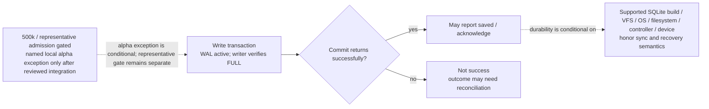

# ADR-002: Persistence Layer

> **Accepted (2026-10-15; durability amendment reviewed and owner-approved 2026-10-15).** SQLite + WAL with bundled `rusqlite` and `rusqlite_migration` is the selected engine. All writers use `synchronous=FULL`; a write is acknowledged only after successful commit. The zero-acknowledged-write-loss target is conditional on the explicitly supported storage/VFS/OS/filesystem stack honoring synchronization and recovery semantics. Acceptance is **not** dependency admission. Dated amendment (2026-10-23): a narrowly scoped `local-catalog-alpha-v1` exception permits the bounded revised local M1–M3 slice only after exact-diff independent Sol review and lead integration. It does not admit representative-scale qualification, pass the 500k gate, or relax WAL/FULL or acknowledgement requirements.

## Context

OxiDJ is a single-process, local-first DJ library manager handling 100k–500k tracks with schema migrations, point-in-time recovery, and per-field provenance. The persistence layer must be simple to distribute, survive power loss, and degrade gracefully. This decision selects the storage engine and Rust stack for M1–M3.

## Decision

Adopt **SQLite with WAL mode** as the default local-first persistence engine:

The flow below summarizes the accepted, conditional WAL/FULL acknowledgement contract; it documents the decision, not an implementation or qualification result. Dependencies for the separate representative-scale qualification route remain gated on the 500k-track prototype. The sole exception is `local-catalog-alpha-v1`, limited to its bounded local-library slice and effective only after exact-diff independent Sol review and lead integration of this amendment; it does not authorize benchmark, fault campaign, qualification, vendor-schema admission, or readiness PASS.

- Rust binding: `rusqlite` with the `bundled` feature (consistent SQLite version, no system dependency).
- Schema migrations: `rusqlite_migration` (uses `user_version`, plain SQL strings).
- Connection model: single writer (bounded channel queue) + read pool (`deadpool`/`r2d2`), `BEGIN IMMEDIATE`.
- Required PRAGMAs on every connection: `journal_mode=WAL`, `synchronous=FULL` on every connection that can write application state, `busy_timeout=5000`, `foreign_keys=ON`, `journal_size_limit=67108864`. Verify the effective settings at connection setup; no writer may silently fall back to NORMAL.
- **Durable acknowledgement:** report a persistent write as saved only after its encompassing transaction commits successfully with FULL sync enabled. Queue admission, SQL statement completion before COMMIT, or UI optimism are not acknowledgements. A commit/sync error is not success; its outcome may require reconciliation.
- **Durability scope:** the target is zero loss of acknowledged commits after OS crash or power interruption, conditional on the supported SQLite build, VFS, OS, filesystem, controller, and storage device honoring SQLite's sync and recovery contract. This does not cover defective/dishonest storage, media destruction, or unsupported filesystems. WAL is host-local; network-mounted databases are outside this decision. Cross-platform compatibility remains separate, and platform-specific stronger sync controls must be assessed before claiming equivalent durability on another platform.
- Backups: `Litestream` is **optional** asynchronous replication, not the backup strategy and not a guaranteed RPO; the `SQLite .backup` API covers ad-hoc/CI. Verified restores and separate protection of external assets (audio files, artwork) are still required.
- Future-proofing: use **domain-facing repository interfaces** rather than a generic SQL-portability trait; add broader portability only when a second backend creates a concrete requirement.

This decision does NOT commit to final schema design — that is deferred to M1 (ADR-005, metadata schema). It commits to the storage engine and binding for the M0–M3 horizon. Acceptance is separate from dependency admission. The dated 2026-10-23 amendment defines the sole early exception, `local-catalog-alpha-v1`, for dependencies required by the reference-only catalog capped at 10,000 tracks. It becomes effective only after exact-diff independent Sol review and lead integration, and carries its own implementation and acceptance evidence. It does not satisfy or bypass the representative 500k gate; all 500k thresholds, protocol, runner, P0/P1, B1/B2 and recovery requirements remain distinct and unpassed. Do not characterize process-crash/reopen/backup evidence as OS/power-loss or 500k qualification. ADR-005 remains Proposed and is not accepted by the local alpha.

### Historical admission wording (retained, scoped by 2026-10-23 amendment)

The 2026-10-15 review, recommendation, and final-ruling records below describe the original representative-prototype-only admission rule in force at that time. They are preserved as historical evidence, but their blanket wording is narrowed prospectively only by the named local alpha exception above. No other dependency route is implied.

## Evidence

- `persistence-evaluation.md` executive summary (line 17): "SQLite with WAL mode is the recommended default" for single-process local-first architecture.
- `persistence-evaluation.md` lines 26-35 contains generic third-party benchmarks and rough size arithmetic only; none are OxiDJ measurements or acceptance evidence, and 500k-track storage footprint remains unknown until the prototype runs.
- `persistence-evaluation.md` lines 37-49 describes the reviewed PRAGMA settings. The prototype must measure the accepted `synchronous=FULL` configuration; generic benchmark figures using other settings are not acceptance evidence.
- `persistence-evaluation.md` lines 73-94: `rusqlite` + `bundled` chosen over `sqlx` (~174 crates, ~19s build) and `diesel` (~26 crates, ~21s build) — lighter, faster builds, honest synchronous API.
- `persistence-evaluation.md` lines 98-122: `rusqlite_migration` uses `PRAGMA user_version` (single integer), plain SQL, tiny crate.
- `persistence-evaluation.md` lines 128-147: Litestream for point-in-time recovery (RPO ~1s), `.backup` API for ad-hoc. Migration prep: abstraction trait, avoid SQLite-specific SQL (lines 197-201).
- `persistence-evaluation.md` lines 205-214: PostgreSQL/MySQL (overkill), DuckDB (OLAP), Redb/sled (no SQL), libSQL (fork risk), SQLCipher (not required).
- `soundcraft.md` line 64 (ADAPT: "Separation of stored metadata and decoded caches") and line 68 (REJECT: "Whole-session JSON plus eagerly decoded media as the library storage design"): separate durable provenance from replaceable analysis; a DJ collection is not a DAW session.

## Options Considered

| Option | Decision | Reason |
|--------|----------|--------|
| SQLite + WAL + rusqlite | **Accepted (admission gated)** | Fits single-process local-first; durable sync is now required; workload gate still unmet |
| PostgreSQL | Rejected | Overkill for local app; operational cost; network latency |
| DuckDB | Rejected | OLAP columnar, not transactional |
| Redb / sled | Rejected | Key-value, no SQL, no migrations, no tooling |
| libSQL (local) | Not yet | Fork risk; server mode not needed in M0 |
| SQLCipher | Not needed | Encryption not an OxiDJ requirement (local-first, user controls files) |

## Consequences

- Distribution: bundled SQLite (via `rusqlite` `bundled`) — no system SQLite dependency.
- Migration path: domain-facing repository interfaces must be introduced early so schema changes can be tested.
- WAL files: Litestream is an optional replication sidecar, not a backup guarantee; `.backup` API available for CI snapshots. Verified restores are required.
- Concurrency: single-writer queue pattern avoids SQLite locking issues.
- Rollback cost: if PostgreSQL becomes necessary (multi-process writes), domain-facing repository interfaces limit the blast radius. Migration budgeted at weeks of engineering time.

## Open Questions / What Would Change This

- Does single-writer become a bottleneck if a future "OxiDJ server" mode emerges? (Threshold: >5% of writes waiting >100ms, or >10K sustained TPS.)
- Does PostgreSQL become necessary? (Threshold per persistence-evaluation.md lines 186-195: only when 2+ of {write contention, >10K TPS, multi-process writes, >1TB} hit simultaneously.)
- Network filesystem support: the WAL database requires a **supported local filesystem**; SQLite is explicitly unsupported on NFS/SMB and FUSE is not assured suitable. Document the local-filesystem requirement.

## Initial Sol Review Packet (historical; durability amended below)

> This packet records the original engine recommendation. Its original synchronous=NORMAL setting is superseded by the owner-approved WAL/FULL durability amendment below; the 500k admission gate and all later findings remain in force.

**DECISION:** Use SQLite with WAL mode, `rusqlite` (bundled), `rusqlite_migration`, domain-facing repository interfaces. Litestream optional, not the backup strategy.

**WHY NOW:** M1-M3 persistence must be chosen before schema design. SQLite is the lowest-risk option that meets all stated requirements.

**CONSTRAINTS:** Single-process local-first. Must handle 100k-500k tracks. Must support migrations, backups, provenance. No multi-process writes in M0 scope.

**OPTIONS:** SQLite + WAL + bundled `rusqlite` + `rusqlite_migration` — **Accepted, dependency admission gated**; PostgreSQL (rejected: overkill), DuckDB (rejected: OLAP), Redb/sled (rejected: no SQL), libSQL (deferred: fork risk), SQLCipher (deferred: not required). The approved durability setting is WAL/FULL; see the amendment below.

**EVIDENCE (historical context only):** persistence-evaluation.md reports third-party read/write TPS, size, build and Litestream estimates. They are not OxiDJ measurements or admission evidence; the 500k-track footprint is unknown until the prototype measures it.

**CURRENT RECOMMENDATION:** SQLite + WAL + bundled `rusqlite` + `rusqlite_migration` (+ optional Litestream). Confidence: medium. The QPS/TPS/size/build-time/RPO figures are **contextual third-party benchmarks, not OxiDJ acceptance evidence**; the estimated 500k-track footprint is not established. What changes it: proven multi-process write requirement, or dataset approaching 1TB while hitting 2+ other thresholds.

**OUTPUT CONTRACT:** No schema design or dependency admission. The bounded implementation experiment and acceptance criteria belong to the 500k-track prototype, which must pass before dependencies enter the workspace.

## Independent Review Outcome (2026-10-15)

**Reviewer:** `gpt-6.1-sol` via `openai-codex`, reasoning **medium**, isolated delegate (no tools, no delegation, this decision only).

**Recommendation returned:** Option 1 **amended** — keep SQLite + WAL + bundled `rusqlite` + `rusqlite_migration`, but (a) treat Litestream as *optional*, not as the complete backup strategy, (b) use **domain-facing repository interfaces** rather than a generic SQL-portability trait, and (c) require the prototype before any dependency enters the M0 workspace.

**Confidence: medium — the ADR's own "high confidence" claim was rejected.** The QPS/TPS/size/dependency figures are contextual claims from third-party benchmarks, not acceptance evidence; they do not model OxiDJ's indexes, analysis payloads, transaction sizes or durability settings.

**Lead verification of the load-bearing claims (checked against primary sources, not accepted on reviewer confidence):**

- **WAL gives reader/writer overlap, not parallel writers.** Confirmed at <https://sqlite.org/wal.html>: *"WAL provides more concurrency as readers do not block writers and a writer does not block readers."* The single-writer model is unchanged. Consequence: concurrent analysis workers must submit **bounded, short, batched transactions through a coordinated writer**. Safety is achievable; acceptable throughput and interactive latency remain **unproven**.
- **Litestream is continuous replication, not a backup story.** Confirmed at <https://litestream.io/how-it-works/>: *"a streaming replication tool… asynchronous replication"* which *"takes over the checkpointing process"* and replicates each database *"to a single replica destination"*. It cannot by itself establish recoverability — accidental deletion and logical corruption propagate, the cited ~1s RPO is not an OxiDJ guarantee, and verified restores plus separate backup of external assets (audio files, artwork) are still required.
- **The generic SQL-portability trait is premature abstraction.** Transactions, indexing, search and migrations stay engine-specific, so the trait buys little portability. Hide SQLite behind application/domain operations; add broader portability only when a second backend creates a concrete requirement.
- **Additional constraint found while verifying:** WAL *"does not work over a network filesystem"* — all processes must be on the same host. Harmless for local-first, but it forecloses a future shared-library-on-NAS design and belongs in the record.

**Status: `Accepted` (final ruling 2026-10-15).** The review gate is satisfied. Acceptance is separate from dependency admission.

## Final Ruling (2026-10-15)

**Reviewer:** `gpt-6.1-sol` via `openai-codex`, reasoning **medium**, isolated delegate (no tools, no delegation, this decision only).

**Ruling: ACCEPT Option 1 as amended. Transition ADR-002 to `Accepted`, with medium confidence.** The precondition is correctly scoped to **dependency admission**, not decision acceptance. Selecting SQLite now does not establish that OxiDJ's workload has passed validation or authorize adding the persistence dependencies yet.

**Carries forward:**
- SQLite + WAL, bundled `rusqlite`, and `rusqlite_migration`.
- A coordinated single writer with bounded, short, batched transactions; WAL permits reader/writer overlap, not parallel writers.
- Domain-facing repository interfaces — not a generic SQL-portability trait.
- Litestream as optional asynchronous replication, not the backup strategy or a guaranteed RPO.
- A **tracked, representative 500k-track prototype gate before the selected persistence dependencies enter the workspace**. It must exercise realistic indexes and payloads, migrations, simultaneous scans/analysis/search, writer-queue behavior, interactive latency, crash/reopen, and retained-backup restore. Define measurable pass criteria before running it. Failure on engine-level requirements reopens the choice; Litestream-specific failure removes Litestream, not SQLite.

**Accepted vs admission:** the decision is accepted; the dependencies stay out of the workspace until the prototype gate passes.

**What would reopen the engine choice:** a 500k-track prototype showing sustained writer-queue growth or unacceptable interactive latency under simultaneous scans, analysis updates and search despite short batched transactions and sound indexing; or a failed crash/reopen or retained-backup restore test. A Litestream-specific packaging or restore failure removes Litestream, not SQLite.

## Durability Amendment (2026-10-15)

**Trigger:** the owner selected zero acknowledged-write loss after OS/power interruption. The accepted `synchronous=NORMAL` setting did not match that requirement. An independent follow-up review by `gpt-6.1-sol` via `openai-codex` recommended WAL/FULL, a commit-success acknowledgement boundary, and an explicitly conditional storage-stack guarantee. The owner accepted that condition. The setting and contract above are amended accordingly; no other engine decision or prototype gate is changed.

**Durability contract:** every connection allowed to write must verify `PRAGMA synchronous=FULL` while WAL is active. Application success/"saved" is reported only after the encompassing transaction's commit returns successfully with FULL enabled. Queue acceptance, an individual statement before commit, and optimistic UI state are not durable acknowledgements. A commit/sync error is not success and may leave an uncertain outcome requiring reconciliation. A WAL commit with FULL sync relies on the supported SQLite build/VFS/OS/filesystem/controller/device honoring sync and recovery semantics; this is not a guarantee against defective or dishonest hardware/storage, media destruction, or unsupported filesystems. WAL remains host-local, not a network-filesystem solution. Cross-platform compatibility is separate; do not claim equivalent durability outside a separately qualified stack.

**Qualification consequences:** run the 500k prototype with FULL, not NORMAL; verify effective settings for every writer and assert ack ordering/error propagation. Recovery tests must compare acknowledged transaction IDs against an independently durable witness and inject process/I/O/sync faults around commit boundaries; permit an unacknowledged transaction to survive, but never accept loss of an acknowledged one. Process termination is not a power-loss simulation, and no finite test campaign proves every device. Record the tested host stack and limit the claim to that supported configuration. Proposed latency/throughput/memory budgets remain provisional until pre-run review.

**Primary evidence verified by the lead:** [SQLite synchronous pragma](https://sqlite.org/pragma.html#pragma_synchronous) documents FULL's additional WAL sync at each commit and NORMAL's possible loss after system/power failure; [SQLite WAL](https://sqlite.org/wal.html) documents that FULL syncs each transaction commit while NORMAL omits the sync; [SQLite atomic commit](https://sqlite.org/atomiccommit.html) describes the dependence of commit safety on underlying flush behavior. See the full advisory and lead verification in [`m1-sqlite-review-outcome.md`](../research/m1-sqlite-review-outcome.md).
