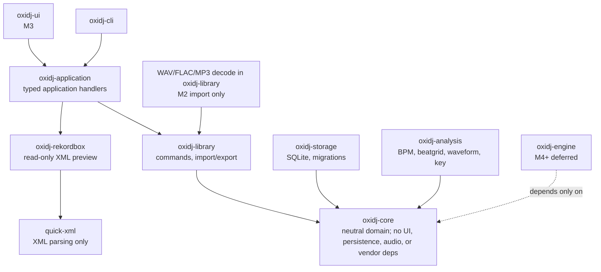

# ADR-004: Crate Boundaries

> **Accepted (2026-10-15).** The independent Sol/medium review is complete and the final ruling is **ACCEPT**. The accepted boundary is the **dependency-rule set**, not a fixed crate inventory. The `oxidj-engine` crate is explicitly deferred to M4 (no realtime-audio implementation in M0).

## Context

OxiDJ must separate domain logic, adapters, UI, persistence, offline decoding/analysis, and the future realtime engine so that each can be built, tested, and versioned independently. SoundCraft's `cargo xtask layers` gate validates UI dependencies do not leak into the library and that adapters are isolated. Offline WAV/FLAC/MP3 decoding is admitted only in `oxidj-library` for the bounded M2 importer; the realtime engine (CPAL + RT-safe DSP) remains separate. GUI and persistence must not define the domain model.

## Decision

Adopt a layered crate architecture with one-way dependency edges:

The dependency sketch shows the accepted one-way direction: product layers depend on the neutral core, not the reverse. It is a rule set, not a requirement to scaffold every crate at once.

The **realtime engine** (`oxidj-engine`: CPAL + dasp/fundsp/rubato) is a separate crate with strictly one dependency edge — `oxidj-core` — and is **not created in M0**. It enters only at M4.

The **M2 decoder exception** is deliberately narrow: `oxidj-library` may use the following as normal dependencies, with no feature additions beyond the stated defaults:

| Crate | Version | Features |
|---|---:|---|
| `hound` | `=3.5.1` | `default-features = false` |
| `claxon` | `=0.4.3` | `default-features = false` |
| `nanomp3` | `=0.2.0` | `default-features = false` |

These decoders are denied in `oxidj-core` and `oxidj-cli`; every other audio dependency remains denied in all product crates, including `oxidj-library`. `nanomp3-core` is not an additional direct-dependency exception. This admission authorizes policy only: decoder dependencies are not added by this ADR amendment. Realtime audio remains isolated in the deferred `oxidj-engine` crate.

**Command-first application layer:** Stateful operations (import, edit, export, analysis) flow through typed internal commands in `oxidj-application`/`oxidj-library`, usable by GUI, CLI, tests, and future automation without duplication. Read-only source previews may use a typed application handler that composes an isolated format adapter directly; the adapter depends only on its parsing library and does not require catalog/library access. This preview path is inspection-only and does not imply catalog mutation or compatibility guarantees. (soundcraft.md ADOPT: "One application-operation path for UI and headless callers.")

**M0 scope:** Only `oxidj-core` and `oxidj-cli` were scaffolded. Additional crates and adapter responsibilities are introduced when implemented responsibilities warrant them. The bounded M4 Rekordbox read-only XML preview is one such adapter; it does not claim application compatibility. The M2 import decoders are hosted directly by `oxidj-library` under the narrow exception above.

## Evidence

- `soundcraft.md` lines 54 (ADOPT): "Keep UI dependencies out of the library/domain and adapters."
- `soundcraft.md` lines 56-57 (ADOPT): "One application-operation path for UI and headless callers."
- `soundcraft.md` lines 60 (ADAPT): "Command registry and JSON control boundary — prefer typed internal requests/results."
- `soundcraft.md` lines 64 (ADAPT): "Separation of stored metadata and decoded caches" — durable provenance separate from replaceable analysis.
- `soundcraft.md` lines 18 (E2): `cargo xtask layers` detects registered upward dependencies and UI-name denylist.
- `audio-platform-evaluation.md` lines 104-121: "Realtime audio isolated from ordinary application code." Lines 200-219: `oxidj-audio` crate with NO cpal dependency; lines 222-240: separate `oxidj-engine` crate (M4+) with cpal + RT-safe DSP.
- `audio-platform-evaluation.md` lines 107-121: Library/Analysis (no realtime reqs) vs. Realtime Engine (separate crate, RT-safe).
- `gui-evaluation.md` cross-cutting: "GUI framework must work with rusqlite (sync) or sqlx (async) read pool" — no UI→core coupling in the other direction.
- `rust-agent-workflow.md` / `cargo-workspaces.md`: workspace shares one lockfile; tests target all members or one package with `-p`.
- `soundcraft.md` REJECT #1: "Whole-session JSON plus eagerly decoded media as the library storage design" — A DJ collection is not a DAW session.

## Options Considered

| Option | Decision | Reason |
|--------|----------|--------|
| Layered crate separation (this ADR) | **Provisional** | Enforces dependencies, supports M0 scaffolding, isolates realtime |
| Single monorepo crate | Rejected | UI/audio/storage coupling; violates SoundCraft ADOPT layer separation |
| Mirror SoundCraft's 7 DAW layers | Rejected | OxiDJ is a library manager, not a DAW — different scope |
| Include realtime engine in M0 | Rejected | No realtime-audio implementation in M0 (acceptance criteria) |
| Vendor formats in core | Rejected | Violates "vendor formats behind adapters" (idea.md) |

## Consequences

- `oxidj-core` has zero dependencies on UI, audio, persistence, or vendor crates — enforceable with a `cargo xtask layers` gate (adapted from SoundCraft).
- The command-first pattern means GUI and CLI share the same import/edit/export path — testable without a window.
- Adapters are isolated crates; adding a new vendor format (e.g., Engine DJ) does not touch core.
- `oxidj-engine` (M4+) depends only on `oxidj-core` — realtime safety is enforced by a single dependency edge.
- M0 scaffolding is minimal: only core + CLI. No premature wiring to GUI, storage, or audio.

## Open Questions / What Would Change This

- Does `oxidj-core` need a dependency on `oxidj-audio` for analysis types? (Proposed: no — core defines neutral types; analysis crate adapts them. Validate when schema is designed.)
- Should storage be a crate or part of core? (Proposed: separate crate — core is pure domain, no persistence knowledge. Validate with first migration.)
- Name for the realtime engine crate: `oxidj-engine` (SoundCraft uses this) or `oxidj-rt` (more explicit)? (Open — decided when M4 is planned.)
- Workspace layout: Cargo workspace at root with all crates, or nested? (Open — M0-08 workspace task will decide.)

## Sol Review Packet

> **Review status: COMPLETED 2026-10-15 (gpt-6.1-sol, reasoning medium). Final ruling: ACCEPT.** The review gate is satisfied. The dependency rules are accepted; M0-08 bootstraps `oxidj-core` + `oxidj-cli` only and owns the layer gate.

**DECISION:** Layered crate architecture — core (domain only) at the bottom, with application handlers composing library and isolated adapters above; storage, analysis, audio, UI, and separate realtime engine crate are added only as implemented responsibilities warrant. Stateful command-first operations flow through application/library; read-only source preview may flow through an application handler to an isolated adapter. M0 scaffolds only core + CLI.

**WHY NOW:** Crate boundaries are difficult-to-reverse (restructuring after code is written costs migration effort). SoundCraft and the audio evaluation both provide evidence. M0-08 (Cargo workspace) depends on this layout.

**CONSTRAINTS:** Core must have zero UI/audio/persistence/vendor dependencies. Realtime engine must be isolated (no CPAL in library/analysis crate). No M5 or realtime-audio implementation in M0. Vendor formats behind adapters. One command path for UI and headless callers.

**OPTIONS:** (1) Layered crates — provisional; (2) single crate — rejected (coupling); (3) mirror SoundCraft's 7 layers — rejected (wrong scope); (4) realtime engine in M0 — rejected (no realtime in M0).

**EVIDENCE:** soundcraft.md line 56 (ADOPT layer separation), line 57 (ADOPT command-first), line 60 (ADAPT typed requests), line 64 (ADAPT metadata/cache separation), line 56/E3 (xtask layers gate); audio-platform-evaluation.md lines 104-121, 200-240 (isolate realtime, separate engine crate); gui-evaluation.md cross-cutting (GUI↔persistence boundary); idea.md (vendor formats behind adapters, realtime isolated from application code).

**CURRENT RECOMMENDATION:** Layered crates with core at the bottom, engine deferred to M4. Confidence: high (four research notes converge). What changes it: finding that core needs to reference audio types at definition time — mitigated by defining neutral types in core, adapters in analysis/audio crates.

**OUTPUT CONTRACT:** M0-08 workspace task inherits these **dependency rules**. Future M1+ tasks create the remaining crates as their responsibilities are actually implemented. Layer gate (`cargo xtask layers`) adapted from SoundCraft must pass before M1.

> **Superseded in part by the review below:** this line originally read "no Cargo workspace is created in M0 until the decision transitions to Accepted". The independent review explicitly approved bootstrapping `oxidj-core` + `oxidj-cli` now and approving the dependency rules ahead of a crate inventory, so M0-08 proceeds on that basis while the ADR stays `Provisional`.

## Independent Review Outcome (2026-10-15)

**Reviewer:** `gpt-6.1-sol` via `openai-codex`, reasoning **medium**, isolated delegate (no tools, no delegation, this decision only).

**Recommendation returned:** Option 1 **with incremental crate creation** — approve the **dependency rules** now, not a fixed six- or seven-crate inventory. M0 contains only `oxidj-core` and `oxidj-cli`. `oxidj-library` appears when application commands actually arrive; storage, analysis, vendor adapters and `oxidj-engine` appear only when implemented.

**Confidence: high.**

**Why the fixed inventory was rejected:**

- Six or seven crates are premature while responsibilities and ADR-003 are still unsettled. Empty crates add public interfaces and coordination cost without enforcing a meaningful boundary — an empty `adapters` crate protects nothing.
- Splitting cohesive private modules *before* stable APIs or persisted contracts exist is cheap; untangling coupled implementations afterwards is not. Layering pays only where the boundary is already known, and merging later still costs import and API churn without recovering the premature interface design.
- **"Zero dependencies" means zero *infrastructure* dependencies, not zero external crates.** Core owns domain IDs and timestamp semantics using small foundational types or newtypes where justified. Serialization belongs in storage/adapter DTOs by default; any serialization dependency inside core must be an explicit, argued exception. A generic shared-types crate is rejected.
- **Offline decoding is not realtime audio I/O.** Analysis may own file decoding and PCM processing without device access; extract a shared decoding crate only if a second consumer genuinely needs it. Device I/O and realtime execution stay deferred to `oxidj-engine`.
- Stateful UI and CLI operations use the same typed application/library command handlers and never access persistence directly. A read-only format preview may instead use an application handler that calls an isolated adapter; that adapter has no catalog/library dependency. Core holds domain types and rules — not application orchestration.

**Counterargument recorded:** modules cannot enforce crate-level dependency isolation. Starting with fewer crates makes accidental coupling easier, and extraction becomes expensive once storage, an async runtime or vendor types leak across boundaries. Creating populated library/storage boundaries immediately would be safer **if** M1 implementation were starting alongside M0.

**Consequence for M0-08:** the workspace bootstraps `oxidj-core` + `oxidj-cli` **only**. The real deliverable is the **dependency-rule gate** — an xtask check that fails on a forbidden edge — which stays meaningful as crates are added, rather than a scaffold of empty crates.

**What would change the decision:** concrete concurrent M0 implementations requiring independent dependency sets, compilation targets or ownership; or an imminent realtime deliverable, which would justify `oxidj-engine` early. Offline decoding alone would not.

## Final Ruling (2026-10-15)

**Reviewer:** `gpt-6.1-sol` via `openai-codex`, reasoning **medium**, isolated delegate (no tools, no delegation, this decision only).

**Ruling: ACCEPT ADR-004, Option 1 with incremental crate creation. Transition to `Accepted`. Confidence: high.**

- The accepted boundary is the **dependency-rule set**, not a fixed crate inventory. Empty crates provide no protection.
- `oxidj-core` owns domain types and rules, with **zero infrastructure dependencies**: no UI, audio, persistence, or vendor dependencies. Justified foundational external crates are permitted.
- Create `oxidj-library` when stateful application command handlers arrive; CLI and UI share those handlers rather than accessing persistence directly. A read-only source-preview handler may compose an isolated adapter without routing through catalog/library commands. Add other crates only when their implemented responsibilities warrant isolation. `oxidj-engine` remains deferred to **M4**.

**M0-08 acceptance criteria (binding):**

1. A working Cargo workspace containing only `oxidj-core` and `oxidj-cli` as product crates; xtask tooling is permitted.
2. An executable `cargo xtask layers` gate enforcing the dependency rules.
3. Verification that the gate **passes the valid workspace and fails on a deliberately planted forbidden dependency edge**, followed by removal of that edge and a passing rerun.

The ADR's suggestion that a single dependency edge guarantees realtime safety must not be treated as a safety proof.
