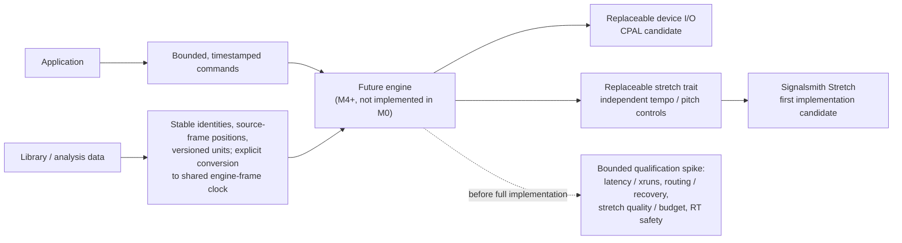

# ADR-008: Audio Engine Foundation

> **Accepted (2026-10-15).** No realtime audio is implemented in M0. This ADR fixes the *boundary* and the *candidate* foundation (CPAL for device I/O, Signalsmith Stretch behind an engine-independent, replaceable trait) so later work does not have to rework the library and analysis crates. The foundation is **not** production-qualified: DJ-grade latency, device recovery and stretch quality on real DJ material are unmeasured.

## Context

OxiDJ needs two decks with sample-accurate scheduling, tempo-matching time-stretch and pitch-shift, low-latency monitoring, and cross-platform device handling (PipeWire/JACK on Linux, WASAPI with opt-in ASIO on Windows, CoreAudio on macOS). The engine arrives at a later milestone, but the dependency and data-boundary choices constrain everything built before it.

OxiDJ has **no licence file yet**. That is not incidental: it decides whether GPL-licensed components are usable at all.

## Decision

CPAL for device I/O, with the time-stretch engine behind an engine-independent trait, and Signalsmith Stretch as the first implementation.

The diagram shows the accepted architectural boundary and the qualification still required before full engine implementation. It is a candidate foundation only: no M0 realtime engine, production qualification, or playback timing is asserted here; the downstream engine work is deferred to M4+.

## Evidence

| Crate | Version | Downloads | Updated | Note |
|---|---|---|---|---|
| `cpal` | 0.18.2 | **24,342,358** | 2026-08-16 | De-facto foundation of the Rust audio ecosystem; backends ALSA/PulseAudio/PipeWire/JACK/WASAPI/ASIO/CoreAudio/AAudio/WebAudio; `realtime` feature for RT thread scheduling; I/O only, no mixing or DSP |
| `rubato` | 5.0.1 | **13,183,853** | 2026-10-01 | Resampling; healthy and active |
| `cubeb` | 0.38.0 | 525,515 | 2026-08-18 | Mozilla's engine; real, but ~46x fewer downloads than cpal and no demonstrated advantage in the evidence |
| `fundsp` | 0.23.0 | 228,606 | 2026-01-07 | DSP graph; slower release cadence |
| `signalsmith-stretch` | 0.1.3 | 117,132 | 2025-09-18 | MIT wrapper for the Signalsmith algorithm; early version but genuinely used |
| `rubberband` | 0.1.5 | **208** | 2026-09-18 | GPL-2.0+/commercial **and** the Rust bindings are effectively unproven |

The `rubberband` finding is decisive on its own: 208 lifetime downloads means the Rust path is untested in practice, quite apart from the licence. Avoid it for both reasons, not just one.

## Independent Review Outcome (2026-10-15)

**Reviewer:** `gpt-6.1-sol` via `openai-codex`, reasoning **low**, isolated delegate (no tools, no delegation, this decision only).

**Recommendation returned:** Option 1, **provisionally** — CPAL for device I/O, Signalsmith Stretch behind an engine-independent trait. Select other DSP dependencies only when needed; **resampling is not a substitute for independent tempo/pitch control**.

**Confidence: medium.** The reviewer's central caution: *"CPAL is a reasonable Rust-first default, **not proof of DJ-grade performance**."* Backend availability, multichannel routing, callback jitter, device recovery and actual monitoring latency all require validation. Neither cubeb nor miniaudio showed a demonstrated advantage in the supplied evidence.

**Licensing reasoning accepted:** Signalsmith's MIT licence preserves permissive options. Distributing a linked Rubber Band implementation under GPL terms would generally require a GPL-compatible combined application; staying permissive needs a commercial licence or a different implementation. GPL acceptance would remove Rubber Band's licensing obstacle — **but would not by itself establish technical superiority.**

**Trait design requirement accepted:** the stretch trait must expose independent tempo and pitch controls, preparation limits, latency, input/output frame accounting, and reset and drain semantics. Allocation and configuration happen outside rendering — **the trait alone cannot make an implementation realtime-safe.**

**Counterargument recorded:** Signalsmith's reported quality does not establish acceptable transient preservation, scratching behaviour, or bounded processing cost on DJ material. CPAL also leaves substantial device-management work to OxiDJ. A commercially licensed proven engine — or cubeb/miniaudio, if device tests favour them — could reduce shipping risk despite the integration cost.

## M0 boundary requirements (the actionable output of this review)

This is what M0 must actually define, per the review:

1. **Separate library/analysis data from engine/device types.** Stable track identities, source-frame positions, versioned beat-grid and analysis units, and an explicit conversion to a shared engine-frame clock.
2. **Define bounded, timestamped commands** between application and engine.
3. **Preallocated PCM transfer**, channel routing, and defined underrun behaviour.
4. **Off-callback decoding and device recovery** — never in the audio thread.
5. **Sample-accurate deck scheduling on the shared clock**, accounting for stretch latency.
6. **Keep both I/O and stretch replaceable.** An Elastique adapter is architecturally sensible, but commercial availability and distribution rights must be established separately.
7. **Document Bluetooth output as unsupported.**

## Open risks

- No measured latency/xrun target exists yet; "low latency" is currently a wish, not a number.
- Signalsmith Stretch quality is unmeasured on DJ material, especially transients and scratching.
- CPAL device-management burden on OxiDJ is unbounded until device tests run.
- Real-time thread priority on Linux may need `rtkit`/realtime D-Bus configuration and user setup.
- ASIO on Windows requires the proprietary SDK and an LLVM/Clang toolchain — opt-in feature, documented build steps.

## What would change the decision

**What would change the decision:** comparative tests showing CPAL missing an explicitly agreed latency/xrun target, or required routing/recovery behaviour, while cubeb or miniaudio meets it; Signalsmith failing blinded DJ-material quality tests or worst-case processing budgets; or affordable commercial licensing plus demonstrably better results from Rubber Band or Elastique.

## Licensing resolution (2026-10-15)

`ADR-009` licences OxiDJ under **MIT**. Rubber Band is therefore excluded on **two independent grounds** — its GPL-2.0+/commercial licence is incompatible with MIT distribution, and its Rust bindings (`rubberband` 0.1.5) have **208 lifetime downloads**, meaning the Rust path is unproven regardless. Signalsmith Stretch (MIT) is compatible and remains the first implementation behind the replaceable trait. A commercial engine such as Elastique would require an explicit commercial decision and is not contemplated now.

## Final Ruling (2026-10-15)

**Reviewer:** `gpt-6.1-sol` via `openai-codex`, reasoning **low**, isolated delegate (no tools, no delegation, this decision only).

**Ruling: ACCEPT Option 1. ADR-008 may transition to `Accepted`.** CPAL is the selected device-I/O foundation; Signalsmith Stretch is the first implementation behind an engine-independent, replaceable trait. This accepts an **architectural foundation — not production qualification** and not a claim of DJ-grade performance.

The absence of measured latency/xrun targets **does not block this M0 decision**: no realtime engine is being delivered, and the required boundaries preserve replacement options. It **does block treating the stack as validated**.

**Risks carried forward:**
- Unmeasured monitoring latency, callback jitter, xruns, backend availability, multichannel routing, and device recovery.
- Unmeasured Signalsmith transient/scratching quality, processing latency, and worst-case callback cost.
- Unknown CPAL device-management effort; Linux realtime-priority setup and opt-in Windows ASIO build requirements.
- Commercial alternatives remain subject to technical evidence and explicit licensing approval. MIT-compatible distribution excludes GPL-linked Rubber Band absent commercial rights; low binding adoption signals uncertainty, not proof of technical failure.

**Before committing to full engine implementation**, define numerical pass/fail targets and run a bounded qualification spike:
- Measure wired end-to-end monitoring latency, callback timing and xruns under representative two-deck load, with specified devices, backends, sample rates, buffer sizes, and test duration.
- Exercise required output/cue routing, device loss/reconnection, configuration changes, and recovery outside the callback.
- Measure stretch latency/frame accounting and worst-case processing budgets; assess transients, tempo/pitch changes, and scratching using representative DJ material and blinded comparisons.
- Verify preallocation and absence of callback allocation/blocking, plus shared-clock scheduling accuracy with stretch-latency compensation.

All seven recorded **M0 boundary requirements remain mandatory**, including replaceable I/O/stretch and unsupported Bluetooth output. Failed qualification triggers the ADR's recorded reconsideration criteria — not a rewrite of library/analysis boundaries.

## D2 addendum (2026-11-05): CPAL admitted, first realtime engine

**What shipped (M8/D2).** `crates/oxidj-audio` (ADR-004 D2 amendment): `cpal =0.18.2` and `rtrb =0.4.1`, both exact pins with default features off (`cargo deny check`: advisories, bans, licences, sources ok; `Unicode-3.0` allow-listed for `unicode-ident`, a proc-macro build dependency of cpal's Android/Windows backends). Two decks play decoded stereo PCM from RAM (`oxidj_library::pcm::decode_stereo`, off the UI thread, with progress) and are mixed at unity. The UI → callback path is a bounded `rtrb` SPSC ring of commands (capacity 256; a full ring refuses, never blocks); callback → UI is per-deck atomics published after every block. Positions are source frames (`f64`); a track whose rate differs from the device rate is read at a fractional step with linear interpolation (equal rates at speed 1 copy samples unchanged). The D1 tempo fader rides the same step as plain varispeed; key lock, sync and Signalsmith stretch remain D3. No device, or a device lost at runtime (`DeviceNotAvailable`, `HostUnavailable`, `StreamInvalidated`), falls back to a silent paced renderer with every deck's state carried over, and the UI says so.

**RT-safety review of the callback (`Renderer::render` + the cpal data/error closures).** No allocation: the device scratch buffer is allocated before the stream is built; commands are moved out of the preallocated ring. No deallocation: the UI keeps a clone of every track it sent and frees a replaced track only once it holds the last reference, so the callback's `Arc` drop is a counter decrement. No lock: `rtrb` pop and `Relaxed`/`Release` atomics only. No I/O, no logging, no syscall other than the vDSO clock read used for timing statistics. No panicking operation: samples are read with `get`, slices are taken with checked `get_mut`, arithmetic is float or saturating. The error closure (cpal runs it on the stream thread) only increments atomics. Review by inspection plus fake-sink unit tests; no allocator instrumentation was run.

**Measured on this machine** (`cargo run --release -p oxidj-audio --example qualify -- 600`): Linux 7.2.15, PipeWire 1.6.10 (graph clock 48 kHz, quantum 1024) reached through cpal's ALSA backend (`pipewire-alsa`, default device "Default Audio Device"), 48 kHz, 2 channels, f32, `BufferSize::Default`, cpal `realtime` feature off (no RT priority requested). Load: both decks playing a 44.1 kHz tone (the fractional-step resampling path) at gain 0 so the owner's speakers stayed silent, loops active. Over 600.1 s: 56,261 callbacks, every block exactly **512 frames** (min = max), mean callback period **10.667 ms**, worst gap between callbacks **38.3 ms**, **1 xrun** (cpal-reported, at 7–8 min), 0 other stream errors, 47,997.7 frames/s delivered. During the same window the machine was compiling and running this card's test suites, so the single xrun is an unloaded-desktop-plus-build result, not an idle-machine result.

**Still NOT DEMONSTRATED.** End-to-end monitoring latency (output buffer depth was not measured), xruns under a pinned RT thread or a smaller quantum, real device loss/reconnection (fallback exercised by a simulated loss flag only), headphone cue routing, Windows/macOS backends, stretch quality and cost. No numeric pass/fail target exists yet, so this is evidence, not qualification; the final-ruling conditions above remain open for D3/D4 and release.

## D3 addendum (2026-11-05): Signalsmith Stretch admitted for key lock

**Evaluation (synthetic signals only; `cargo run --release -p oxidj-audio --example stretch_eval`).** Candidates: `signalsmith-stretch =0.1.3` (Signalsmith's default preset: 120 ms block, 30 ms interval) and a minimal in-house phase vocoder written for the comparison (2048-point Hann STFT, ¾ overlap, identity phase locking, naive radix-2 FFT; offline, `f64`). Stereo, 48 kHz, 512-frame blocks, this machine (Linux 7.2.15), release build, desktop not idle, no RT priority.

| Measure | Signalsmith (default) | In-house PV |
|---|---|---|
| CPU per deck, tempo 0.84 / 1.00 / 1.16 | 1.50 / 1.05 / 1.29 % of one core (cheaper preset 0.89 / 0.70 / 0.78 %) | 2.02 / 2.53 / 1.98 % (offline, unoptimised) |
| Through the deck engine (`Renderer::render`, one key-locked deck) | 1.18 / 1.03 / 1.15 %, worst block 0.51 ms of the 10.667 ms budget | — |
| 1 kHz sine, key lock, ±8/±16 %: pitch | 999.98 Hz (−0.04 cents) at every tempo | 999.98 Hz (−0.04 cents) |
| … spurious energy outside ±30 Hz | −57.5 / −76.9 / −53.5 / −66.2 dB (−16/−8/+8/+16 %) | −44.6 / −49.0 / −50.3 / −47.6 dB |
| … output peak for a 0.9 input | 0.93 / 0.92 / 1.04 / 1.11 (overshoot up to +1.8 dB) | 0.90 |
| Click track (2 ms bursts, 1.60 ms wide at −20 dB): width | 2.07 / 2.08 / 1.41 / 1.38 ms | 4.66 / 2.89 / 2.60 / 3.55 ms |
| … pre-echo (20 ms before onset vs 10 ms after) | −22.3 / −24.8 / −26.4 / −22.9 dB | −27.3 / −22.6 / −22.5 / −24.4 dB |
| … click peak retained (0.9 in) | 0.72–0.75 | 0.48–0.63 |
| Latency | 2,880 + 2,880 frames (60 + 60 ms) | 2,048-frame window |
| Heap use in `process` (glibc `mallinfo2`, 5,625 blocks per run) | 0 bytes, 0 blocks changed | n/a (offline) |

Signalsmith is cleaner (3–28 dB less spurious energy on a tone), keeps transients tighter (≈1.4–2.1 ms vs 2.6–4.7 ms) and louder, and costs less CPU than the unoptimised vocoder; pitch accuracy is equal. Its one measured weakness is tonal overshoot (up to +1.8 dB on a sine at +16 %): the engine's existing hard clamp at ±1.0 bounds the output, and the click-track test asserts no clipping. One isolated 22.5 ms block appeared in one 60 s Signalsmith run (default preset, +16 %; the other five runs stayed ≤ 1.9 ms, the engine-level runs ≤ 0.51 ms) on a busy desktop without RT priority: worst-case callback cost is **not** qualified.

**Licence and dependency tree.** `signalsmith-stretch` (wrapper, MIT, Colin Marc), the vendored Signalsmith Stretch C++ (MIT, Signalsmith Audio) and `signalsmith-linear` (MIT). Normal dependencies: `dasp` 0.11 family (MIT/Apache-2.0). Build dependencies: `cc` and `bindgen` 0.70 (`clang-sys`, `libloading`, `regex`, `nom`, `cexpr`, `prettyplease`, …; BSD-3/MIT/Apache-2.0/ISC). 27 new lock entries. `cargo deny check`: advisories, bans, licences, sources ok (duplicate-version warnings only, e.g. a second `shlex`). Build requirements added: a C++14 compiler and libclang (present here: clang 23); Windows/macOS builds need the same toolchain, not yet tried.

**Decision.** Admit `signalsmith-stretch =0.1.3` (exact pin, default features off) into `oxidj-audio` only (ADR-004 D3 amendment; `cargo xtask layers` allow-lists it there and denies it everywhere else). It sits behind the engine-independent `TimeStretch` trait (`crates/oxidj-audio/src/stretch.rs`): tempo by the input/output length ratio, independent pitch (`set_transpose`), latency, reset and pre-roll; construction and warm-up allocate off the callback. The in-house vocoder is not shipped (it remains in the evaluation example only).

**How key lock and SYNC work.** Key lock reads the deck at the plain rate-conversion step and lets Signalsmith change the tempo by `speed` (`speed × frames` input per output block); without key lock the fader stays varispeed. The published deck position is the audible one: the stretch engine is primed `lag = input latency + output latency × speed` ahead of it on every start/jump/toggle, so cue points, loops, the UI playhead and SYNC see what is heard. SYNC is a callback command: it sets the follower's speed (master BPM × master speed / follower BPM, from least-squares constant fits of the imported-or-computed grids; imported wins) and jumps the follower to the nearest position with the master's beat phase, using both decks' live positions in the same block. The UI refuses SYNC with a visible reason for an empty or still-decoding deck, no grid, a computed grid below confidence 0.5, a variable-tempo grid (beats > 3 ms off one tempo) or a tempo outside the fader range.

**Evidence (tests, synthetic only).** `keylock_tests.rs`: Signalsmith ratio/length invariants and no clipping on a 0.9-peak click track at ±8/±16 %; 1 kHz kept within 0.5 Hz with key lock, following the tempo without; latency-compensated position (first click heard < 1 ms from where the position says, at 0.92/1.00/1.16); SYNC of a 126 BPM/48 kHz deck to a 120 BPM/44.1 kHz deck: every rendered click within 1 ms, with and without key lock on either deck. `tests/rt_alloc.rs`: 1,500 `render` calls with key lock, SYNC, seeks, loops, cues, tempo changes and loads: 0 Rust allocator events and 0 glibc heap changes inside `render` (with controls proving both detectors fire). UI (`deck_tests.rs`): KEY/SYNC through the real buttons, phase error < 1 ms from engine positions, both BPM readouts 122.40, live seam readout `Δ ±0 ms · +0.00 BPM`, warped beat lines of both halves within 1 px, B follows A's fader, B's fader releases SYNC, double-click resets; every refusal reason exact and visible.

**Tempo change while key-locked (accepted limitation).** The published position follows the read head's own tempo history (one output latency back, minus the input latency), so it never moves backwards, settles at the new tempo, keeps short loops in range, and stays < 1 ms on every click already in the pipeline or more than one stretch block (120 ms) after the fader move (`key_lock_tempo_change_keeps_position_monotonic_and_on_the_clicks`, `key_lock_tempo_change_just_before_a_beat_stays_on_the_click`, `key_lock_short_loop_stays_in_range_and_repeats`). A click 2,400–5,800 source frames after the move falls in the block Signalsmith synthesises across the ratio change and is placed at a block-quantised time: measured up to 3.9 ms (1.0 → 0.84) and 2.3 ms (1.0 → 1.16), not monotonic in the offset, so no monotonic position can follow it. Only that one beat per fader move is affected; the next beat is < 1 ms again, and the test bounds it at 5 ms. SYNC is unaffected (it sets tempo and phase together and re-primes).

**Still NOT DEMONSTRATED.** Listening quality on real DJ material (owner's check), scratching, blinded comparison, worst-case callback cost under an RT thread, tempo maps with tempo changes (refused visibly), non-Linux builds of the C++ dependency.

## D4 addendum (2026-11-05): in-house mixer DSP, no new dependency

**What shipped (M8/D4).** `crates/oxidj-audio/src/mixer.rs`: an optional two-channel DJ mixer in the callback, written in-house (no dependency admitted). Per channel: trim (±12 dB), a 3-band isolator EQ (kill to +6 dB), a one-knob colour filter (left low-pass 20 kHz → 120 Hz, right high-pass 20 Hz → 7 kHz, 2nd order, Q 1, centre dead zone = off), the channel fader and a crossfader assign A / THRU / B; then a crossfader (Smooth / Sharp / Cut, both channels at unity from the centre to their own side), master volume and peak meters with clip flags for each channel (after trim/EQ/filter, before the fader) and the master (before the output clamp).

**EQ design.** Linkwitz-Riley 4th-order crossovers at 250 Hz and 2.5 kHz, each two cascaded RBJ Butterworth biquads (transposed direct form II, `f64` state). The low band passes a 2nd-order all-pass at the upper crossover, so at 0 dB the three bands sum to a flat-magnitude all-pass (measured within ±0.05 dB from 30 Hz to 18 kHz); the mixer therefore shifts phase but never changes level at unity. Measured kill depth (48 kHz, steady sine): low at 40 Hz −63.7 dB, mid at 790 Hz (band centre, the weakest point of 24 dB/octave skirts) −34.3 dB, high at 14 kHz −71.8 dB.

**RT safety.** The whole mixer state (`MixerParams`, `Copy`) travels as one `Command::Mixer` through the existing ring; filter coefficients are recomputed in the callback by plain arithmetic when a knob moves; gains ramp linearly across each 256-frame chunk; meters are `fetch_max` on `AtomicU32` (positive `f32` bits order like the floats) plus an `AtomicBool`, swapped to zero by the UI read. Filter state below 1e-25 is flushed to zero (no denormals) and a non-finite state resets the strip and drops that chunk (a NaN sample cannot latch the filters). `tests/rt_alloc.rs` now also moves the mixer (EQ kills, filter sweeps across both sides, crossfader positions and curves, assign changes, show/hide) during its 1,500 `render` calls: 0 Rust allocator events, 0 glibc heap changes. Worst-case callback cost of the mixer is not measured.

**Bypass.** `Command::Mixer(None)` (the UI sends it whenever the mixer section is hidden, which is the default) takes the mixer out of the path entirely: the decks sum exactly as in D2/D3, tested bit-identical against an engine that never had a mixer, including after heavy mixer settings and at odd block sizes (`mixer_tests::hidden_mixer_is_bit_identical_to_no_mixer`, UI `deck_tests::hidden_mixer_is_bit_identical_whatever_the_knobs_say`). The crossfader has its own toggle; hidden, it is out of the path (both channels at unity regardless of assign).

**Still NOT DEMONSTRATED.** Listening on real material (owner's check), worst-case callback cost under an RT thread, headphone cue / PFL (out of scope), FX, MIDI controllers.

## Live-readiness addendum (2026-11-10, branch `audio-engine`)

Workstream record: `plan/AUDIO.md`. User guide: `docs/audio-output.md`. No new dependency; cpal's optional hosts are reached through cargo features of `oxidj-audio` only.

**Targets (first numeric ones for this ADR).** Recommended buffer 256 frames at 48 kHz (the engine itself asks for the host default unless a buffer is set); output latency 10 ms or less on a realtime host (JACK, ASIO) and 20 ms or less on shared hosts; 0 xruns in 10 minutes with two key-locked decks and the mixer; worst render time 30 % or less of the block; lost device retried and taken back without a restart.

**Decisions.**

1. *Output selection* (`OutputConfig`, `list_outputs`, `Engine::start_with`, `Engine::reopen`): host, device (stable cpal id or name), sample rate, buffer frames and channel count, from a settings screen or from `OXIDJ_AUDIO_*` environment keys. A rate or channel count the device lacks is an error, never a silent downgrade, so a missing cue pair is visible.
2. *Device loss*: the silent fallback stays, and `Engine::poll` now retries the wanted device every 2 s and moves the decks back onto it. Engines that never had a device do not retry.
3. *Resampling*: linear interpolation is replaced by an in-crate 32-tap Kaiser-windowed sinc (128 phases, eight cutoffs chosen by read speed (1.0, 0.95, 0.9, 0.85, 0.7, 0.5, 0.35, 0.25 of the band) so faster reads are band-limited first; the steps are coarse, so just below each step a little content above the output's Nyquist remains, and beyond 4x nothing narrower exists). Zero phase, so positions keep their meaning; integer positions at full bandwidth still return the stored frame bit for bit.
4. *Declick*: real outputs fade 3 ms on play, pause, cue, seek, sync, load and at loop seams (the old signal continues as a fading tail under the new one fading in; the two gains sum to 1). The hand-driven test renderer stays sample-exact unless a test asks for the fade. Limits: a key-locked deck gets the fade-in only. Its old signal is the stretch output, which a plain read of the track does not match sample for sample, so no tail is laid over it and a pause or jump still ends that signal on one sample (at most its own amplitude); key-locked loop seams are not crossfaded either (the seam is inside the stretch input). A second jump while a fade is running keeps one tail, the louder of the two signals, so the remaining step is at most half the level; two jumps in one callback fade cleanly from what was heard.
5. *Master limiter* (`Command::Limiter`, on by default): instant attack, 150 ms release, both channels by one gain; exactly 1.0 below full scale, so quiet mixes stay bit-identical and the hidden-mixer bypass contract holds. The clamp remains as the last safety. No look-ahead: the first over of a burst is scaled, not anticipated.
6. *Backends*: features `asio`, `jack`, `realtime`, `realtime-dbus` forward to cpal. WASAPI exclusive mode is not available in cpal 0.18.2 and is parked.
7. *Key lock stays on the Signalsmith default preset.* The cheaper preset splits the transform across callbacks (worst block 0.5 ms instead of 1.2 ms) but changes block and interval, and `key_lock_tempo_change_just_before_a_beat_stays_on_the_click` then fails its 5 ms bound (6.0 ms measured). Parked until the wrapper exposes split computation for the default preset or the position model is re-derived and listened to.

**Measured on this machine** (Linux 7.2.15, PipeWire, 48 kHz, release build, two decks of 44.1 kHz material at +8 % and -4 %, mixer on, master at 0).

| Path | Buffer | Reported latency | Worst render | Worst load | Mean load | xruns |
|---|---|---|---|---|---|---|
| `bench` (no device), varispeed | 128 | n/a | 0.04 ms | 1.4 % | 0.6 % | n/a |
| `bench` (no device), key lock | 128 | n/a | 1.18 ms | 44 % | 2.9 % | n/a |
| `bench` (no device), key lock | 256 | n/a | 1.16 ms | 22 % | 2.9 % | n/a |
| ALSA through PipeWire (thread not realtime), key lock | 512 (default) | 37.3 ms | 1.3 ms | 12 % | | 0 in 15 s |
| same | 256 | 21.3 ms | up to 8 ms (scheduling) | over 100 % | 4 to 6 % | 0 to 1 in 12 s |
| same | 128 | 13.3 ms | up to 3.7 ms (scheduling) | over 100 % | 4 to 6 % | 0 to 1 in 12 s |
| JACK host (PipeWire JACK, realtime thread), key lock | 256 | 8.0 ms | 1.13 ms | 21 % | 3.5 % | 0 in 15 s |
| same | 128 | 4.0 ms | 1.18 ms | 44 % | 3.5 % | 0 in 15 s |
| JACK host, varispeed | 128 | 4.0 ms | 0.04 ms | 1.5 % | 0.8 % | 0 in 15 s |

Reading: the engine itself is cheap; the only burst is the key-lock transform (about 0.6 ms per deck every 30 ms). On a realtime thread the callback numbers equal the offline bench, so the latency and load targets are met at 256 frames through JACK. The shared-host target (20 ms) is NOT met on the PipeWire ALSA bridge: 21.3 ms at 256 frames and 37.3 ms at the host default. Through the PipeWire ALSA bridge the thread is not realtime (cpal promotes hardware devices only) and the spikes are scheduling, on a desktop that was also compiling. Runs were 12 to 15 s; the 10-minute run was not repeated for this addendum.

**Evidence (tests, synthetic only).** `resample.rs` tests: stored frame returned at integer positions; level within 1 % and error under 2 % to 16 kHz at 44.1 to 48 kHz where linear interpolation is off by more than 20 %; a 20 kHz tone read at double speed is removed (under 0.3 %) while 5 kHz passes; edges and extreme positions never read outside. `tests.rs`: declick ramps for play and pause, constant level across seeks and loop seams, old track faded out on reload and released afterwards, bounded step on a 0.5 jump; limiter keeps the wave shape at +4 dB over, clips when off, recovers, and is bit-identical below full scale; environment keys; failed host falls back, schedules a retry and keeps the decks (the retry branch of `poll` that takes a device back is not executed by any test); a Load still in the ring survives a reopen; engines without a device never retry; unknown decks are refused before the ring; two jumps in one callback and a jump in mid-fade are bounded on a staircase track. `tests/rt_alloc.rs` runs with declick on: 0 allocations.

**Still NOT DEMONSTRATED.** ASIO, WASAPI, CoreAudio and any Windows or macOS build; a real USB sound card and a real unplug and replug (the reconnect path has never taken a device back, in a test or by hand); a 4-channel device through the new selection path (the cue bus itself is tested on the fake sink); listening tests of the resampler, declick time and limiter on real material; a 10-minute run on the JACK path.

