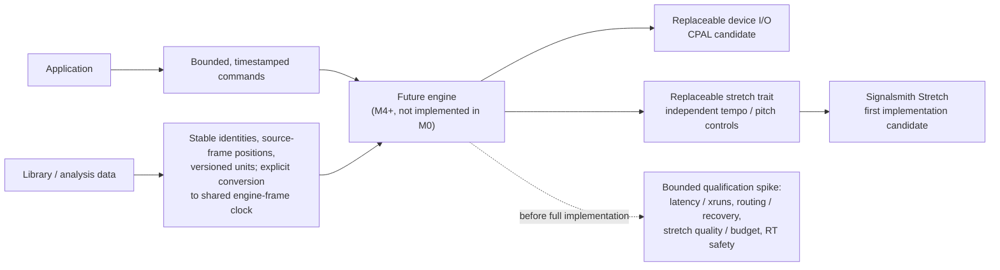

# ADR-008: Audio Engine Foundation

> **Accepted (2026-10-15).** No realtime audio is implemented in M0. This ADR fixes the *boundary* and the *candidate* foundation (CPAL for device I/O, Signalsmith Stretch behind an engine-independent, replaceable trait) so later work does not have to rework the library and analysis crates. The foundation is **not** production-qualified: DJ-grade latency, device recovery and stretch quality on real DJ material are unmeasured.

## Context

OxiDJ needs two decks with sample-accurate scheduling, tempo-matching time-stretch and pitch-shift, low-latency monitoring, and cross-platform device handling (PipeWire/JACK on Linux, WASAPI with opt-in ASIO on Windows, CoreAudio on macOS). The engine arrives at a later milestone, but the dependency and data-boundary choices constrain everything built before it.

OxiDJ has **no licence file yet**. That is not incidental: it decides whether GPL-licensed components are usable at all.

## Decision

CPAL for device I/O, with the time-stretch engine behind an engine-independent trait, and Signalsmith Stretch as the first implementation.

The diagram shows the accepted architectural boundary and the qualification still required before full engine implementation. It is a candidate foundation only: no M0 realtime engine, production qualification, or playback timing is asserted here; the downstream engine work is deferred to M4+.

## Evidence

| Crate | Version | Downloads | Updated | Note |
|---|---|---|---|---|
| `cpal` | 0.18.2 | **24,342,358** | 2026-08-16 | De-facto foundation of the Rust audio ecosystem; backends ALSA/PulseAudio/PipeWire/JACK/WASAPI/ASIO/CoreAudio/AAudio/WebAudio; `realtime` feature for RT thread scheduling; I/O only, no mixing or DSP |
| `rubato` | 5.0.1 | **13,183,853** | 2026-10-01 | Resampling; healthy and active |
| `cubeb` | 0.38.0 | 525,515 | 2026-08-18 | Mozilla's engine; real, but ~46x fewer downloads than cpal and no demonstrated advantage in the evidence |
| `fundsp` | 0.23.0 | 228,606 | 2026-01-07 | DSP graph; slower release cadence |
| `signalsmith-stretch` | 0.1.3 | 117,132 | 2025-09-18 | MIT wrapper for the Signalsmith algorithm; early version but genuinely used |
| `rubberband` | 0.1.5 | **208** | 2026-09-18 | GPL-2.0+/commercial **and** the Rust bindings are effectively unproven |

The `rubberband` finding is decisive on its own: 208 lifetime downloads means the Rust path is untested in practice, quite apart from the licence. Avoid it for both reasons, not just one.

## Independent Review Outcome (2026-10-15)

**Reviewer:** `gpt-6.1-sol` via `openai-codex`, reasoning **low**, isolated delegate (no tools, no delegation, this decision only).

**Recommendation returned:** Option 1, **provisionally** — CPAL for device I/O, Signalsmith Stretch behind an engine-independent trait. Select other DSP dependencies only when needed; **resampling is not a substitute for independent tempo/pitch control**.

**Confidence: medium.** The reviewer's central caution: *"CPAL is a reasonable Rust-first default, **not proof of DJ-grade performance**."* Backend availability, multichannel routing, callback jitter, device recovery and actual monitoring latency all require validation. Neither cubeb nor miniaudio showed a demonstrated advantage in the supplied evidence.

**Licensing reasoning accepted:** Signalsmith's MIT licence preserves permissive options. Distributing a linked Rubber Band implementation under GPL terms would generally require a GPL-compatible combined application; staying permissive needs a commercial licence or a different implementation. GPL acceptance would remove Rubber Band's licensing obstacle — **but would not by itself establish technical superiority.**

**Trait design requirement accepted:** the stretch trait must expose independent tempo and pitch controls, preparation limits, latency, input/output frame accounting, and reset and drain semantics. Allocation and configuration happen outside rendering — **the trait alone cannot make an implementation realtime-safe.**

**Counterargument recorded:** Signalsmith's reported quality does not establish acceptable transient preservation, scratching behaviour, or bounded processing cost on DJ material. CPAL also leaves substantial device-management work to OxiDJ. A commercially licensed proven engine — or cubeb/miniaudio, if device tests favour them — could reduce shipping risk despite the integration cost.

## M0 boundary requirements (the actionable output of this review)

This is what M0 must actually define, per the review:

1. **Separate library/analysis data from engine/device types.** Stable track identities, source-frame positions, versioned beat-grid and analysis units, and an explicit conversion to a shared engine-frame clock.
2. **Define bounded, timestamped commands** between application and engine.
3. **Preallocated PCM transfer**, channel routing, and defined underrun behaviour.
4. **Off-callback decoding and device recovery** — never in the audio thread.
5. **Sample-accurate deck scheduling on the shared clock**, accounting for stretch latency.
6. **Keep both I/O and stretch replaceable.** An Elastique adapter is architecturally sensible, but commercial availability and distribution rights must be established separately.
7. **Document Bluetooth output as unsupported.**

## Open risks

- No measured latency/xrun target exists yet; "low latency" is currently a wish, not a number.
- Signalsmith Stretch quality is unmeasured on DJ material, especially transients and scratching.
- CPAL device-management burden on OxiDJ is unbounded until device tests run.
- Real-time thread priority on Linux may need `rtkit`/realtime D-Bus configuration and user setup.
- ASIO on Windows requires the proprietary SDK and an LLVM/Clang toolchain — opt-in feature, documented build steps.

## What would change the decision

**What would change the decision:** comparative tests showing CPAL missing an explicitly agreed latency/xrun target, or required routing/recovery behaviour, while cubeb or miniaudio meets it; Signalsmith failing blinded DJ-material quality tests or worst-case processing budgets; or affordable commercial licensing plus demonstrably better results from Rubber Band or Elastique.

## Licensing resolution (2026-10-15)

`ADR-009` licences OxiDJ under **MIT**. Rubber Band is therefore excluded on **two independent grounds** — its GPL-2.0+/commercial licence is incompatible with MIT distribution, and its Rust bindings (`rubberband` 0.1.5) have **208 lifetime downloads**, meaning the Rust path is unproven regardless. Signalsmith Stretch (MIT) is compatible and remains the first implementation behind the replaceable trait. A commercial engine such as Elastique would require an explicit commercial decision and is not contemplated now.

## Final Ruling (2026-10-15)

**Reviewer:** `gpt-6.1-sol` via `openai-codex`, reasoning **low**, isolated delegate (no tools, no delegation, this decision only).

**Ruling: ACCEPT Option 1. ADR-008 may transition to `Accepted`.** CPAL is the selected device-I/O foundation; Signalsmith Stretch is the first implementation behind an engine-independent, replaceable trait. This accepts an **architectural foundation — not production qualification** and not a claim of DJ-grade performance.

The absence of measured latency/xrun targets **does not block this M0 decision**: no realtime engine is being delivered, and the required boundaries preserve replacement options. It **does block treating the stack as validated**.

**Risks carried forward:**
- Unmeasured monitoring latency, callback jitter, xruns, backend availability, multichannel routing, and device recovery.
- Unmeasured Signalsmith transient/scratching quality, processing latency, and worst-case callback cost.
- Unknown CPAL device-management effort; Linux realtime-priority setup and opt-in Windows ASIO build requirements.
- Commercial alternatives remain subject to technical evidence and explicit licensing approval. MIT-compatible distribution excludes GPL-linked Rubber Band absent commercial rights; low binding adoption signals uncertainty, not proof of technical failure.

**Before committing to full engine implementation**, define numerical pass/fail targets and run a bounded qualification spike:
- Measure wired end-to-end monitoring latency, callback timing and xruns under representative two-deck load, with specified devices, backends, sample rates, buffer sizes, and test duration.
- Exercise required output/cue routing, device loss/reconnection, configuration changes, and recovery outside the callback.
- Measure stretch latency/frame accounting and worst-case processing budgets; assess transients, tempo/pitch changes, and scratching using representative DJ material and blinded comparisons.
- Verify preallocation and absence of callback allocation/blocking, plus shared-clock scheduling accuracy with stretch-latency compensation.

All seven recorded **M0 boundary requirements remain mandatory**, including replaceable I/O/stretch and unsupported Bluetooth output. Failed qualification triggers the ADR's recorded reconsideration criteria — not a rewrite of library/analysis boundaries.

## D2 addendum (2026-11-05): CPAL admitted, first realtime engine

**What shipped (M8/D2).** `crates/oxidj-audio` (ADR-004 D2 amendment): `cpal =0.18.2` and `rtrb =0.4.1`, both exact pins with default features off (`cargo deny check`: advisories, bans, licences, sources ok; `Unicode-3.0` allow-listed for `unicode-ident`, a proc-macro build dependency of cpal's Android/Windows backends). Two decks play decoded stereo PCM from RAM (`oxidj_library::pcm::decode_stereo`, off the UI thread, with progress) and are mixed at unity. The UI → callback path is a bounded `rtrb` SPSC ring of commands (capacity 256; a full ring refuses, never blocks); callback → UI is per-deck atomics published after every block. Positions are source frames (`f64`); a track whose rate differs from the device rate is read at a fractional step with linear interpolation (equal rates at speed 1 copy samples unchanged). The D1 tempo fader rides the same step as plain varispeed; key lock, sync and Signalsmith stretch remain D3. No device, or a device lost at runtime (`DeviceNotAvailable`, `HostUnavailable`, `StreamInvalidated`), falls back to a silent paced renderer with every deck's state carried over, and the UI says so.

**RT-safety review of the callback (`Renderer::render` + the cpal data/error closures).** No allocation: the device scratch buffer is allocated before the stream is built; commands are moved out of the preallocated ring. No deallocation: the UI keeps a clone of every track it sent and frees a replaced track only once it holds the last reference, so the callback's `Arc` drop is a counter decrement. No lock: `rtrb` pop and `Relaxed`/`Release` atomics only. No I/O, no logging, no syscall other than the vDSO clock read used for timing statistics. No panicking operation: samples are read with `get`, slices are taken with checked `get_mut`, arithmetic is float or saturating. The error closure (cpal runs it on the stream thread) only increments atomics. Review by inspection plus fake-sink unit tests; no allocator instrumentation was run.

**Measured on this machine** (`cargo run --release -p oxidj-audio --example qualify -- 600`): Linux 7.2.15, PipeWire 1.6.10 (graph clock 48 kHz, quantum 1024) reached through cpal's ALSA backend (`pipewire-alsa`, default device "Default Audio Device"), 48 kHz, 2 channels, f32, `BufferSize::Default`, cpal `realtime` feature off (no RT priority requested). Load: both decks playing a 44.1 kHz tone (the fractional-step resampling path) at gain 0 so the owner's speakers stayed silent, loops active. Over 600.1 s: 56,261 callbacks, every block exactly **512 frames** (min = max), mean callback period **10.667 ms**, worst gap between callbacks **38.3 ms**, **1 xrun** (cpal-reported, at 7–8 min), 0 other stream errors, 47,997.7 frames/s delivered. During the same window the machine was compiling and running this card's test suites, so the single xrun is an unloaded-desktop-plus-build result, not an idle-machine result.

**Still NOT DEMONSTRATED.** End-to-end monitoring latency (output buffer depth was not measured), xruns under a pinned RT thread or a smaller quantum, real device loss/reconnection (fallback exercised by a simulated loss flag only), headphone cue routing, Windows/macOS backends, stretch quality and cost. No numeric pass/fail target exists yet, so this is evidence, not qualification; the final-ruling conditions above remain open for D3/D4 and release.
