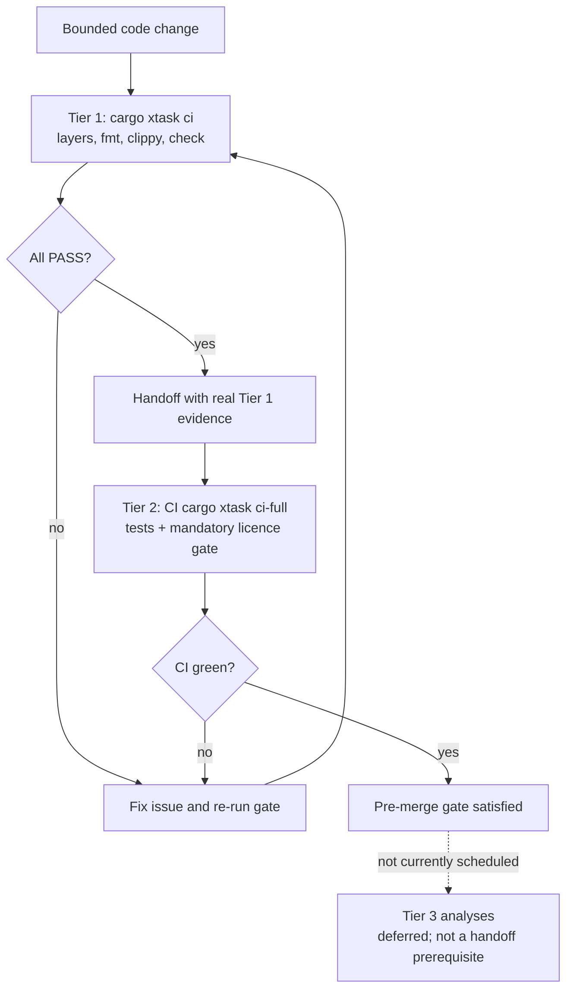

# Rust development baseline

M0-02, verified 2026-10-15. This guide establishes tooling and workflow. The repository now has a Cargo workspace, CLI, `xtask`, and CI; the M0-02 task itself did not include a product Cargo manifest.

## Setup

Use user-local rustup, not a parallel system Rust installation. On a fresh machine, obtain the installer from [rustup's official site](https://rustup.rs/), review it, then run it without sudo:

```sh
curl --proto '=https' --tlsv1.2 -fLsS https://sh.rustup.rs -o rustup-init.sh
sh rustup-init.sh -y --profile minimal --default-toolchain stable
. "$HOME/.cargo/env"
rustup component add --toolchain stable rustfmt clippy rust-analyzer rust-src
```

If rustup is already installed, do not reinstall it or silently replace the user's default toolchain:

```sh
rustup toolchain install stable --profile minimal
rustup component add --toolchain stable rustfmt clippy rust-analyzer rust-src
rustup show
rustup component list --toolchain stable --installed
rustc +stable -Vv
cargo +stable -V
cargo +stable fmt --version
cargo +stable clippy --version
rustup run stable rust-analyzer --version
bash scripts/rust-toolchain-smoke.sh
```

Stable is a moving channel, not reproducible by itself. The tested host toolchain is Rust/Cargo 1.99.0, x86_64-unknown-linux-gnu. To reproduce that compiler explicitly: `rustup toolchain install 1.99.0 --profile minimal --component rustfmt --component clippy --component rust-analyzer --component rust-src`, then run `RUSTUP_TOOLCHAIN=1.99.0 bash scripts/rust-toolchain-smoke.sh`. M0-08 committed a `rust-toolchain.toml` (`channel = "1.99.0"`, `profile = "minimal"`, components `rustfmt`/`clippy`/`rust-analyzer`/`rust-src`); refresh the pin intentionally with committed green-gate evidence. **MSRV declared (M0-10 §7.4):** the MSRV is `1.99.0`, declared as `rust-version` in the workspace `Cargo.toml` and `msrv` in `clippy.toml` — see [Quality gate: MSRV](#msrv).

A native linker/C build toolchain is also needed; `cc --version` succeeded on this host. Platform-specific linker/SDK setup must be verified when adding Windows/macOS CI; this Linux smoke test is not cross-platform validation. No sudo, shell-profile changes, additional targets, nightly or global Cargo helpers were needed here.

The smoke script creates and removes a dependency-free crate under `$TMPDIR` (fallback: `$HOME/.cache/oxidj`), isolates its target directory, and needs no crate registry access. Intentional compiler, formatter, lint and regression failures precede the final PASS. It is a toolchain probe, not a product test suite. An existing rustup toolchain override in `RUSTUP_TOOLCHAIN` is respected; default is stable. The installer path is documented, but reinstalling rustup on a pristine host was not exercised in this audit.

## Quality gate

The repo-owned gate is defined by `AGENTS.md` and implemented as `cargo xtask` (`xtask/src/main.rs`). CI runs `cargo xtask ci-full`; the per-handoff gate is `cargo xtask ci`. The research gate report is background, not the current command source.

The quality flow below distinguishes the mandatory per-handoff Tier 1 gate, the CI/pre-merge Tier 2 gate, and deferred Tier 3 analyses; failures return to fixing and re-running the relevant gate.



### Tier 1 — every coding handoff (stable, fast, <2 min warm)

Tier 1 uses stable `rustfmt`/`clippy` and the project layers guard. It makes no network advisory-database calls, but Cargo may fetch locked dependencies if the local cache is cold. Run `cargo xtask ci` (the repo-owned wrapper) or the matching raw commands below:

```sh
cargo xtask layers                                              # ADR-004 dependency guard; must PASS (fails on a planted forbidden edge)
cargo fmt --all -- --check                                       # exit 0
CARGO_BUILD_WARNINGS=deny cargo clippy --workspace --all-targets --all-features --keep-going --locked   # 0 warnings
cargo check --workspace --all-targets --all-features --locked                         # exit 0
```

The committed `[build] warnings = "deny"` in `.cargo/config.toml` is the persistent form of the warnings-deny rule (§7.3); `CARGO_BUILD_WARNINGS=deny` is set redundantly by `cargo xtask ci` so the gate is self-contained even if a shell overrides the config. `--keep-going` surfaces *all* lints, not just the first error. A clean-tree Tier-1 run is the bar for any handoff evidence.

### Tier 2 — pre-merge / CI (stable; target 1–5 min)

Run by CI via `cargo xtask ci-full` (tests + the licence gate):

```sh
cargo test --workspace --all-features --locked     # native test runner used by ci-full
cargo deny check licenses             # ADR-009 — MIT allow-list; GPL/LGPL/AGPL/SSPL denied by default
```

The licence gate is **Tier 2 and mandatory in the full gate**: `ADR-009` makes the permissive-only policy an enforced build gate, so `cargo deny check licenses` runs in `cargo xtask ci-full` before merge; the CI workflow installs pinned cargo-deny 0.20.2 before the gate. The separate advisory scan `cargo audit` runs as a best-effort, non-blocking CI check. `deny.toml` allow-lists MIT, Apache-2.0, BSD-2-Clause, BSD-3-Clause, ISC, Unicode-DFS-2016, Zlib; every other license — including all of the GPL/LGPL/AGPL/SSPL families — is denied by default because it is not allow-listed. Rubber Band, Slint's free tier, and Qt are therefore unavailable without an explicit commercial/licensing decision.

- **Local availability:** `cargo-deny 0.20.2` is installed on the current development host and is required if running `cargo xtask ci-full` locally; GitHub CI installs the pinned version first. `cargo-audit`, `cargo-machete`, and `typos` are absent locally but attempted by CI as best-effort, non-blocking advisories. `cargo-nextest` and `cargo-mutants` are not used by the current gate; tests use native `cargo test`, and Nextest remains deferred until the product suite demonstrates a need. `cargo xtask ci` is the required local fast gate; do not install the optional tool set wholesale. See `docs/handoff-checklist.md` for evidence requirements.

### Tier 3 — deferred analyses (not currently scheduled in this repository)

These are candidate slow/nightly checks, not part of the current gate. The only
workflow in `.github/workflows` has push/pull-request triggers; no scheduled
Tier-3 job exists. If these analyses are later adopted, isolate them in a
pinned nightly workflow that never enters the handoff environment:

```sh
cargo +nightly miri test                       # UB in executed paths (only crates with `unsafe`)
cargo +nightly udeps                           # precise unused deps
cargo +nightly semver-checks check-release     # breaking public API vs baseline (nightly rustdoc JSON)
cargo mutants                                  # mutation score (mutants.out/outcomes.json) — enable only after test stability is established
```

`miri`/`mutants` can take tens of minutes; schedule them only after a dedicated
workflow is configured, not as an assumed current CI check.

### Optional tooling (install only for a justified need)

Tier 1 uses the pinned rustup components described in §Setup. `cargo xtask ci-full` additionally requires cargo-deny; if it is absent locally, install the same version used by CI with this user-local command (no sudo):

```sh
cargo install cargo-deny --locked --version 0.20.2
```

`cargo-audit`, `cargo-machete`, and `typos` are best-effort CI advisories and do not need to be installed for the local Tier-1 handoff gate. `cargo-nextest`, `cargo-mutants`, and nightly-only analyzers are not used by the current required gate; defer them until a reviewed project need justifies the installation. Do not install the entire candidate tool list wholesale.

### MSRV

The **MSRV is declared as Rust 1.99.0**: `rust-version = "1.99.0"` in the workspace `Cargo.toml` and `msrv = "1.99.0"` in `clippy.toml` (§7.4). The `rust-toolchain.toml` pin (`channel = "1.99.0"`, profile `minimal`) reproduces the tested compiler; it is a reproducibility pin, not itself the MSRV assertion — declaring `rust-version` is what makes Clippy's `msrv` lint and the `[lints]` edition groups meaningful. Declaring *something* is the decision; revisit only with deliberate, evidence-backed change.

### Agent diagnostics

Consume **machine-readable JSON, not an LSP client**: `cargo check ... --message-format=json` or `cargo clippy --message-format=json`; parse newline records by `reason` (`compiler-message` carries `code`/`spans`/`children`/`rendered`). The rust-analyzer **LSP client is deferred** until shown to measurably reduce agent iterations (§7.5) — the argument for it is capability-based, not empirically proven, so prefer the `rust-analyzer diagnostics .` / `analysis-stats .` CLI for navigation (see `docs/rust-analyzer-cli.md`). Keep `[lints]` + `clippy.toml` `msrv` green = the Tier-1 gate (§7.5).

## Compiler-driven agent loop

1. Read intent, plan and applicable policies. Verify cwd, branch, manifest and working-tree state. Trace definitions/usages before calling an API. Read diagnostics instead of guessing a replacement dependency or symbol.
2. For a bug, first reproduce the behavior and add a deterministic test asserting the correct result. Observe a relevant failure on the original code. Fix the implementation, not the expectation. If a test cannot represent the failure (hardware, external format, nondeterminism), preserve the minimal reproducer and record the exception before claiming a fix.
3. Change one bounded concern. Use focused package/target checks and tests, then broaden the gate. Fix root diagnostics first; cascading errors are not independent design requirements.
4. Use rust-analyzer for navigation and early feedback, but require Cargo output. `cargo check` skips code generation/linking; it is not a build or runtime proof. Review compiler/lint suggestions against behavior; do not blanket-allow warnings to turn a gate green.
5. After about three unsuccessful attempts on the same diagnostic cluster, report commands, errors and attempted fixes for escalation. Preserve real output and current diff; do not replace a failed run with plausible output.

M0-08 has bootstrapped the workspace (`Cargo.toml` at the root, `crates/oxidj-core` + `crates/oxidj-cli`) and made `cargo xtask` the authoritative gate. For targeted single-package feedback, use commands shaped like these — the exact Tier-1/2/3 commands are in [Quality gate](#quality-gate):

```sh
cargo metadata --format-version 1 --no-deps
cargo check -p <actual-package> --all-targets
cargo test -p <actual-package> <regression-filter> -- --exact
cargo fmt --all -- --check
cargo clippy --workspace --all-targets --locked -- -D warnings
cargo build --workspace --all-targets --locked
cargo test --workspace --all-targets --locked
cargo test --workspace --doc --locked
```

The exact filter must be the fully qualified test name; verify that at least one intended test ran. Bare `cargo test` follows default-members, and `--all-targets` does not replace doctests. Feature combinations must be chosen from the actual manifest: do not assume `--all-features` is a valid combination. `--locked` requires the application's committed, current lockfile. Use `--offline` only for dependency-free probes or known cached dependencies, not to mask normal fresh-clone fetch requirements. This is why the repo-owned `cargo xtask` gate is authoritative rather than duplicated command lists in CI — `.github/workflows/ci.yml` calls `cargo xtask ci-full`, not inline cargo commands.

For machine-readable diagnostics, use `cargo check ... --message-format=json`, retain stdout and stderr separately, and inspect exit status. Parse newline records by `reason`; compiler-message has code/spans/children/rendered text. Tolerate unknown fields and non-JSON subprocess output. `rustc --explain <actual-code>` gives detailed compiler guidance. Use `RUST_BACKTRACE=1 cargo test ... -- --nocapture` when needed; sanitize logs before sharing. JSON is an optional troubleshooting interface, not a new custom agent framework. Warnings are denied via the persistent `[build] warnings = "deny"` in `.cargo/config.toml` (preferred over per-shell `-D warnings`); the JSON-over-LSP diagnostics policy and the full tiered commands are in [Quality gate](#quality-gate) (rust-quality-gates.md §7).

## Bug reproduction invariant and fixtures

A bugfix handoff includes: revision/diff, compiler version, feature/target flags, exact command, smallest lawful fixture, expected versus actual result, RED output before the fix, GREEN output after it, and broader gate results. A failing build or missing fixture is not the required behavioral RED. If the regression is flaky, fix/isolate nondeterminism before treating one passing run as proof. Do not delete/ignore a failing test or weaken assertions without an explicit reviewed behavior change.

For future M1–M4 tests:

- Unit tests cover pure rules; integration tests cover persistence/adapters/public API; doctests keep promised usage executable.
- Store small redistributable or synthetic fixtures with provenance, license/permission, format/version, expected semantics, and any known loss. Do not commit private music, credentials or personal library identifiers. Preserve immutable raw evidence separately from expected results.
- Use per-test temporary files/databases. Tests run concurrently; do not share mutable cwd, environment, caches or a user's real library. Resolve fixture paths relative to the package manifest, not a presumed repo-root cwd.
- Roundtrip checks compare independent semantic expectations for cues/loops/grid/key/BPM, unknown metadata and ordering rules, not just bytes or an importer and exporter that can share the same mistake. Record intentional loss explicitly.
- Persistence tests eventually cover reopen/migrations/transactions and interrupted writes; malformed-input tests belong at format boundaries. Fuzzing/property/performance tools are justified once parsers, invariants and measured hot paths exist, not as bootstrap dependencies.

These are test requirements for later implementation, not a claim that product fixture/roundtrip tests already exist.

## Worktree and agent isolation

Use one task per worktree/branch and one worker per profile; preserve the project model policy and fail-safe empty fallback. A worktree does not sandbox globally installed tools, shell state, profile configuration, or shared wiki content.

Before/after execution, run `pwd`, `git rev-parse --show-toplevel`, `git branch --show-current`, `git status --short`, and independently `git -C <canonical-checkout> status --short`. Compare with the recorded starting state. Use explicit absolute workspace paths when invoking a child CLI. A fixed Hermes terminal.cwd can override intent: inspect supported configuration and verify real file readback in the intended directory before dispatch. Avoid shared mutable `CARGO_TARGET_DIR` between workers; worktree-local defaults are adequate initially.

Completion does not integrate a branch or uncommitted files. Lead integration must place approved parent changes into the downstream workspace before running its acceptance gate. Do not commit/push automatically. Shared policy/plan/wiki navigation files are collision hotspots; report them and serialize edits instead of silently overwriting a sibling's changes.

See [the sourced tooling/skills audit](research/rust-agent-workflow.md) and the canonical agent knowledge/model policies. External research is compiled in the existing Hermes `/llm-wiki`; no separate wiki engine or session-memory feature is introduced.
