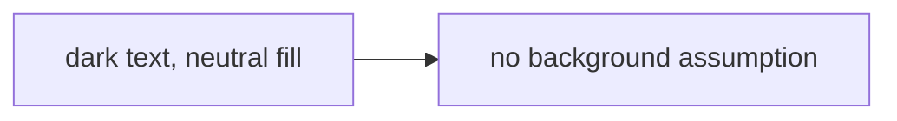
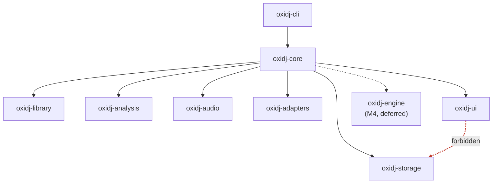
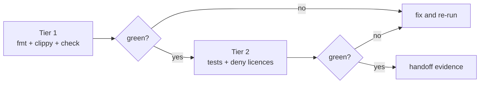
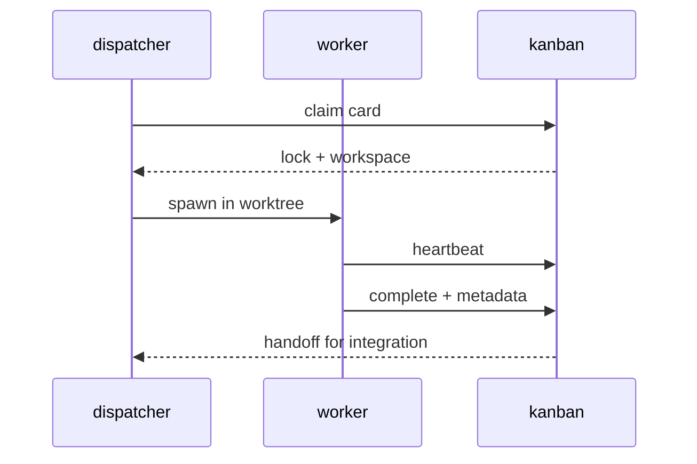

# Diagram conventions

OxiDJ docs use Mermaid for live diagrams, and committed images for anything that must adapt to light/dark mode. This page is the working convention. The sourced research behind it is [`docs/research/diagram-conventions.md`](research/diagram-conventions.md).

## 1. Pick the correct diagram for the thing

## Project diagram catalog

The links below point to implemented project diagrams, not the examples and
templates later on this page. ADR-005, agent-policy, and M1 status/protocol
diagrams are deferred from this catalog while those documents have pre-existing
uncommitted changes.

| Diagram | Subject | Type |
|---|---|---|
| [Offline architecture and deferred realtime engine](architecture.md#6-audio-architecture) | Separates offline library/analysis work from the deferred realtime engine. | `flowchart LR` |
| [Accepted crate dependency direction](adr/004-crate-boundaries.md#decision) | Shows product layers depending on the neutral core. | `flowchart TB` |
| [Current layer model and gate example](layers-policy.md#the-layer-model) | Illustrates the layer model and current layer-gate example. | `flowchart TB` |
| [Metadata lifecycle](adr/003-metadata-representation.md#decision) | Summarizes the accepted non-destructive metadata lifecycle. | `stateDiagram-v2` |
| [Semantic mapping and export](semantic-mapping.md#8-summary-open-vs-closed-questions) | Shows policy-level mapping/export, preserving uncertainty and reporting unsupported or lost fields. | `flowchart LR` |
| [GUI prototype direction and evidence gates](adr/001-gui-framework.md#decision) | Summarizes the M3 prototype direction and separate evidence gates. | `flowchart TB` |
| [Audio boundary and qualification](adr/008-audio-engine.md#decision) | Shows the architectural boundary and qualification required before M4+ engine implementation. | `flowchart LR` |
| [Conditional persistence acknowledgement](adr/002-persistence.md#decision) | Shows the conditional WAL/FULL acknowledgement contract; not implementation or qualification evidence. | `flowchart LR` |
| [Development quality gate](development.md#quality-gate) | Distinguishes handoff Tier 1, CI/pre-merge Tier 2, and deferred Tier 3 analysis. | `flowchart TD` |
| [Handoff evidence path](handoff-checklist.md#handoff-checklist--required-evidence-format-for-coding-tasks) | Shows required handoff evidence, full CI/pre-merge checks, and deferred analysis. | `flowchart TD` |
| [Testing strategy in the gate](testing.md#how-the-strategy-is-enforced) | Places focused checks and workspace tests in the existing gate tiers. | `flowchart TD` |

The [Excalidraw companion](diagrams/architecture-boundary.excalidraw) is an
illustrative mirror of the architecture Mermaid above, not an independent
specification. Mermaid remains canonical.

The examples and templates below are illustrative conventions, not additional
project diagrams.

| Subject | Use | Why |
|---|---|---|
| Architecture layers, crate dependency rules | `flowchart` (`TB`/`LR`) | Directed dependency graph |
| Quality-gate tiers (handoff/CI flow) | `flowchart` | Staged process with pass/fail branches |
| Worker / dispatch flows | `sequenceDiagram` | Time-ordered messages between processes |
| Database schema (ADR-005) | `erDiagram` | Entities and cardinality |
| Rust type model (neutral domain types) | `classDiagram` | Types, fields, links |
| Import lifecycle, gate states | `stateDiagram-v2` | Named states and transitions |
| Release / branching strategy | `gitGraph` | Git history specifically |
| Scheduled milestones | `gantt` | Calendar time, not logical order |
| Brainstorm / topic expansion | `mindmap` | Radial hierarchy (experimental) |
| Ordered history within periods | `timeline` | Sequence matters more than exact dates |

**Do not use C4** (`C4Context` / `C4Container` / `C4Component`). GitHub's bundled Mermaid does not ship the C4 extension, so C4 blocks render as **raw text** on GitHub ([community discussion #197898](https://github.com/orgs/community/discussions/197898)); it is also marked experimental. Use `flowchart` + `subgraph` for the same layered view.

## 2. Dark/light mode — the honest constraint

**GitHub does not adapt Mermaid diagrams to the viewer's colour scheme.** GitHub renders ` ```mermaid ` blocks inside a sandboxed iframe that does not follow `prefers-color-scheme`; the background stays light ([mermaid#5034](https://github.com/mermaid-js/mermaid/issues/5034)). `%%{init}%%` theme directives are unreliable there and deprecated since Mermaid v10.5.0. So there are two profiles:

### Profile A — inline Mermaid (default)

Keep diagrams **theme-agnostic**: dark strokes and text, neutral/light fills, and no assumption about the page background. These stay legible on both GitHub light and GitHub dark. Most OxiDJ diagrams should be this.



### Profile B — adaptive images (when dual-theme contrast matters)

Pre-render two SVGs (light + dark) and embed with GitHub's documented `<picture>` + `prefers-color-scheme`:

```html
<picture>
  <source media="(prefers-color-scheme: dark)" srcset="docs/diagrams/layers-dark.svg">
  
</picture>
```

The lighter-weight alternative is GitHub's `#gh-dark-mode-only` / `#gh-light-mode-only` URL fragments. Both need **pre-rendered files**, because an uploaded SVG has its internal `@media` CSS sanitised away.

### Self-hosted docs (M1+, not yet decided)

Only if OxiDJ later self-hosts its docs (MkDocs/Mintlify) does true adaptive Mermaid become available: use `theme: 'base'` — the only theme whose `themeVariables` can be overridden — plus `themeCSS` referencing host CSS custom properties, and re-render on the `prefers-color-scheme` change. Note `themeVariables` accept **hex only** (`var(--x)` is *not* resolved there; it works only in `themeCSS`), and colour names like `red` are silently ignored.

## 3. Media tags

| Reader | Use | Notes |
|---|---|---|
| GitHub docs, live diagram | ` ```mermaid ` | GitHub renders it; no author `alt` text |
| GitHub docs, image | `` | Commit the file; **alt text required** |
| GitHub docs, adaptive | `<picture>` + `prefers-color-scheme` | Two files, light + dark |
| Hermes chat reply | state the absolute path | The gateway attaches it automatically |

**Never commit a `MEDIA:` tag.** `MEDIA:/abs/path` is a Hermes chat-gateway convention, not Markdown — in committed docs it renders as literal text. This is the single most common media-tag mistake.

## 4. Templates

**Crate layers and the forbidden edge** (`flowchart` + `subgraph`, one layer per diagram):



`linkStyle` indexes edges in declaration order — count them before editing.

**Quality-gate tiers** (`flowchart` with a pass/fail branch):



**Worker dispatch** (`sequenceDiagram`):



**Metadata schema sketch** (`erDiagram`) and **type model** (`classDiagram`) are reserved for ADR-005 (M1); add them there, not here.

## 5. Guardrails

- **Quote breaking tokens.** `End` terminates `flowchart` and `sequenceDiagram` — write `'End'`.
- **Avoid deprecated directives.** Prefer frontmatter `config` over `%%{init}%%` where supported; on GitHub, rely on the default theme instead.
- **Respect `maxEdges`.** Split layers into separate diagrams rather than emitting every transitive edge.
- **Always caption non-decorative diagrams in prose.** Inline Mermaid has no author `alt` text on GitHub, so a diagram must never be the only carrier of information.
- **Pin to long-stable syntax** (`flowchart`, `sequenceDiagram`, `classDiagram`, `erDiagram`, `gantt`). GitHub's bundled Mermaid lags the latest release, so `block-beta`/`architecture-beta` and the `neo`/`redux` theme names may not render.
- **Review diagrams as images.** Render each new diagram (`mmdc`) and check it as an image before committing — both for legibility in light *and* dark, and to confirm the diagram type actually fits the subject.
