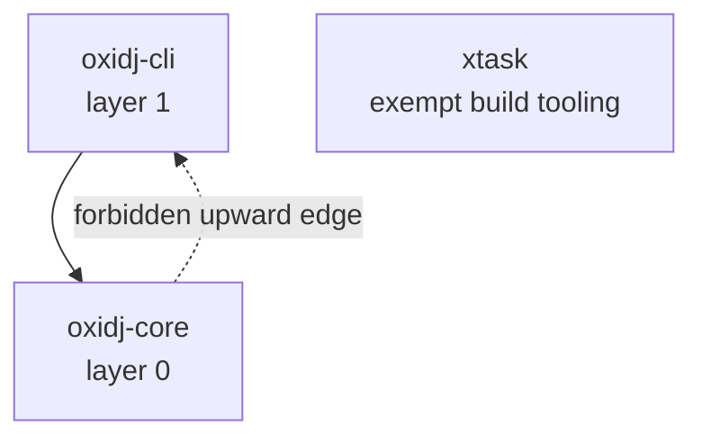

# Dependency layer policy and the `cargo xtask layers` gate

M0-08. This is the **durable deliverable** of the crate-boundary decision
(ADR-004): a gate that fails on a forbidden dependency edge, and stays meaningful
as crates are added later.

## The layer model

Lower layer number = closer to the domain core. A crate may depend **only** on
crates at the **same layer or lower**. Depending on a higher layer is a forbidden
(upward) edge.

| Layer | Crate        | Role                                                     |
|-------|--------------|----------------------------------------------------------|
| 0     | `oxidj-core` | Neutral domain model and rules. Zero infrastructure deps. |
| 1     | `oxidj-cli`  | Command-line entry point; calls core handlers only.       |
| exempt| `xtask`      | Build-time tooling (`cargo xtask`), never a product dep.  |

This small graph illustrates the current M0 rule in both directions: `cli` may
depend on the lower-layer core, while the reverse edge is forbidden. `xtask` is
outside the product dependency graph.



M0 contains **only** `oxidj-core` and `oxidj-cli`. Storage, audio, analysis,
adapters and UI are **not** scaffolded — they appear when their functionality
is needed, each assigned a layer here (ADR-004's review rejected an empty-crate
scaffold: it enforces no boundary while adding public surface and coordination
cost).

## What the gate enforces

1. **Internal edges point down or across, never up.** A path dependency to a
   workspace member whose layer is *higher* fails. (`cli` → `core` is allowed;
   `core` → `cli` is forbidden.)
2. **No infrastructure crates in core or CLI.** A dependency whose name is on a
   denylist (audio / ui / persistence / vendor) fails, regardless of whether it
   is a normal, dev, or build dependency — so a forbidden `dev-dependency` is
   also caught.
3. **Every new product crate must be classified.** A workspace member with no
   layer assignment fails until it is added to the layer table in
   `xtask/src/main.rs`. This is what keeps the gate meaningful as the crate set
   grows.

The gate reads `cargo metadata --no-deps` (offline; it does not resolve or fetch
dependencies), so it can detect a violation even when the offending crate is
declared but not yet available — which is exactly how the planted-violation demo
below works.

## Planting and removing a forbidden edge (the required demonstration)

The gate is shown **failing** on a deliberately introduced violation, and
**passing** once it is removed — not merely passing on a clean tree.

```sh
# 1. clean tree: passes
cargo xtask layers

# 2. plant a forbidden edge: an audio crate inside oxidj-core
#    (edit crates/oxidj-core/Cargo.toml -> [dependencies] -> cpal = "0.1")
#    Run the pre-built gate binary directly so Cargo does not re-resolve the
#    (intentionally unresolvable) planted dependency into Cargo.lock:
./target/debug/xtask layers        # FAILS: forbidden audio dependency 'cpal'

# 3. remove the planted line, then pass again (both invocations agree)
cargo xtask layers                 # PASS
```

The direct-binary invocation is used only to isolate the *policy* failure from a
stale-lockfile side effect; the failure message is produced by the same
`cargo xtask layers` logic the canonical `cargo xtask ci` runs.

## When a crate is added (M1+)

1. Add the crate under `crates/`, a member of the workspace, with a one-way edge
   toward a lower-or-equal layer.
2. Assign it a layer in `layer_of` in `xtask/src/main.rs`.
3. Run `cargo xtask layers` and commit only when it passes.

The gate is the single source of truth for the boundary. Do not weaken the
denylists or the upward-edge rule to make a build pass; that defeats the ADR-004
review's whole point.
