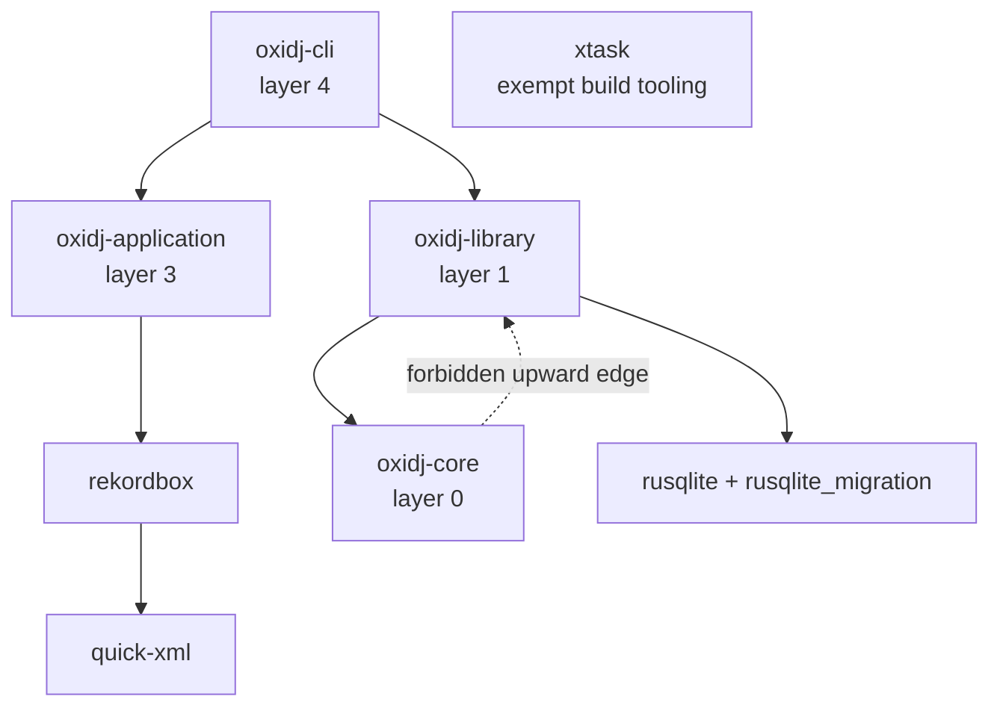

# Dependency layer policy and the `cargo xtask layers` gate

M0-08. This is the **durable deliverable** of the crate-boundary decision
(ADR-004): a gate that fails on a forbidden dependency edge, and stays meaningful
as crates are added later.

## The layer model

Lower layer number = closer to the domain core. A crate may depend **only** on
crates at the **same layer or lower**. Depending on a higher layer is a forbidden
(upward) edge.

| Layer | Crate | Role |
|-------|-------|------|
| 0 | `oxidj-core` | Neutral domain model and rules; zero infrastructure deps. |
| 1 | `oxidj-library` | Shared catalog/application handlers; owns SQLite and migrations. |
| 2 | `oxidj-rekordbox` | Isolated vendor XML adapter (M4 preview). |
| 3 | `oxidj-application` | Orchestrates shared handlers and adapter operations for callers. |
| 4 | `oxidj-cli` | Thin command-line presentation; calls application/library handlers. |
| exempt | `xtask` | Build-time tooling (`cargo xtask`), never a product dep. |

The dependency path for vendor operations is CLI → application handler → isolated
adapter, while catalog operations still use the library handlers; the adapter's
vendor parsing does not enter the CLI, application domain, or library. The Rekordbox
adapter is layer 2, the application orchestration layer is layer 3, and the CLI is
layer 4. Persistence remains owned by the library; the core cannot depend upward.
`oxidj-library` alone may depend on `rusqlite` and `rusqlite_migration`; all
other persistence dependencies remain forbidden. For the bounded M2 importer,
`oxidj-library` may also have normal dependencies on Hound `=3.5.1`, Claxon
`=0.4.3`, and nanomp3 `=0.2.0`, each with `default-features = false` and no
explicit features. These decoders remain forbidden in core and CLI; every other
audio crate remains forbidden in every product crate. `nanomp3-core` is not a
separate direct-dependency exception. The dependencies are not added by this
policy change. `xtask` is outside the product dependency graph.



The bounded M1 local-catalog slice populates `oxidj-library`; it is not an empty
scaffold. The M4 preview keeps XML parsing in `oxidj-rekordbox` at layer 2; the
application handler invokes that adapter and exposes it to the CLI without making
the parser a CLI or library dependency. Other vendor adapters, audio analysis and UI
remain outside this slice.

## What the gate enforces

1. **Internal edges point down or across, never up.** A path dependency to a
   workspace member whose layer is *higher* fails. (`cli` → `core` is allowed;
   `core` → `cli` is forbidden.)
2. **Infrastructure stays behind its owner.** Core and CLI deny audio, UI,
   persistence and vendor crates. Library allows only `rusqlite` and
   `rusqlite_migration` from persistence and the three named M2 decoders from
   audio; it denies all other audio, UI, other persistence and vendor crates.
   These checks include normal, dev and build dependencies.
3. **Every new product crate must be classified.** A workspace member with no
   layer assignment fails until it is added to the layer table in
   `xtask/src/main.rs`. This is what keeps the gate meaningful as the crate set
   grows.

The gate reads `cargo metadata --no-deps` (offline; it does not resolve or fetch
dependencies), so it can detect a violation even when the offending crate is
declared but not yet available — which is exactly how the planted-violation demo
below works.

## Planting and removing a forbidden edge (the required demonstration)

The gate is shown **failing** on a deliberately introduced violation, and
**passing** once it is removed — not merely passing on a clean tree.

```sh
# 1. clean tree: passes
cargo xtask layers

# 2. plant a forbidden edge: an audio crate inside oxidj-core
#    (edit crates/oxidj-core/Cargo.toml -> [dependencies] -> cpal = "0.1")
#    Run the pre-built gate binary directly so Cargo does not re-resolve the
#    (intentionally unresolvable) planted dependency into Cargo.lock:
./target/debug/xtask layers        # FAILS: forbidden audio dependency 'cpal'

# 3. remove the planted line, then pass again (both invocations agree)
cargo xtask layers                 # PASS
```

The direct-binary invocation is used only to isolate the *policy* failure from a
stale-lockfile side effect; the failure message is produced by the same
`cargo xtask layers` logic the canonical `cargo xtask ci` runs.

## When a crate is added (M1+)

1. Add the crate under `crates/`, a member of the workspace, with a one-way edge
   toward a lower-or-equal layer.
2. Assign it a layer in `layer_of` in `xtask/src/main.rs`.
3. Run `cargo xtask layers` and commit only when it passes.

The gate is the single source of truth for the boundary. Do not weaken the
denylists or the upward-edge rule to make a build pass; that defeats the ADR-004
review's whole point.
