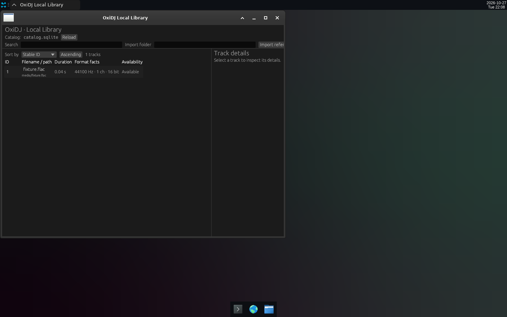
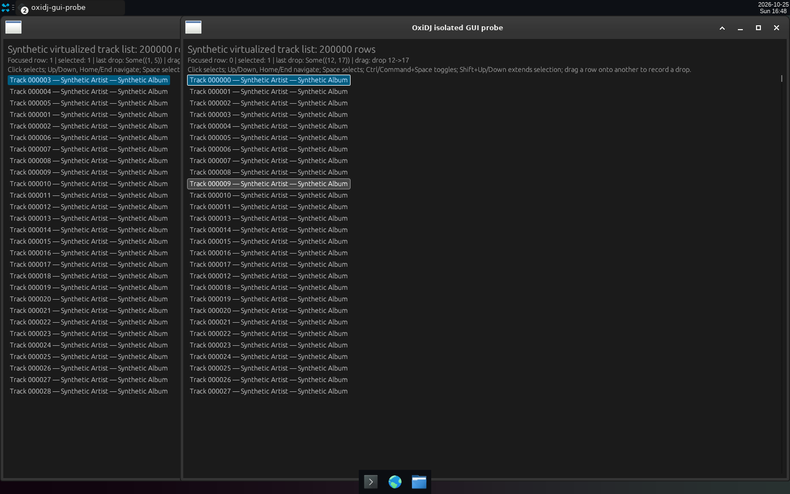

# v0.1 — First pixels: a persisted local-library window and the 200,000-row virtualized GUI probe.

Date: 2026-10-25 – 10-27 · Evidence commits: `c3b256f..41dd2a6` · Raw evidence: [`pre-alpha-01`](../archive/pre-alpha-01/)

## What changed for the user

- M3 Local Library shows a persisted SQLite catalog: filename, duration, format facts and availability per track, plus an empty-library import prompt.
- ADR-001 GUI probe: keyboard navigation over a 200,000-row synthetic virtualized list (Home/End boundaries).

## Key screenshots

Local Library with one synthetic `tone.flac` track (2026-10-27). Source: [`archive/pre-alpha-01/01-local-library-startup.png`](../archive/pre-alpha-01/01-local-library-startup.png).

`oxidj-gui-probe`: synthetic 200k-row list at the Home boundary (2026-10-25). Source: [`archive/pre-alpha-01/03-gui-probe-home-boundary.png`](../archive/pre-alpha-01/03-gui-probe-home-boundary.png).

## Provenance and gates

Genuine Bot Screen captures (`DISPLAY=:20`, 1440×900), synthetic fixture only. Not a performance, accessibility or production-GUI qualification. Gate results (`cargo xtask ci`/`ci-full`) and test names for each change are recorded in the archived READMEs and the commit bodies. Nothing here is Rekordbox/OneLibrary compatibility, accessibility, platform or performance qualification evidence.

[← Timeline](../README.md)
