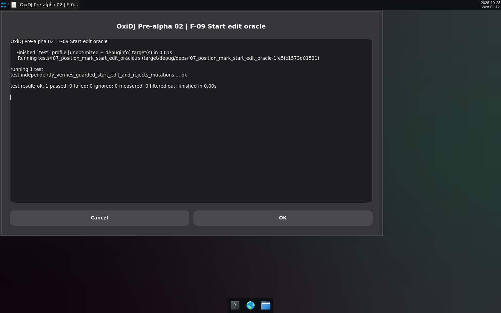
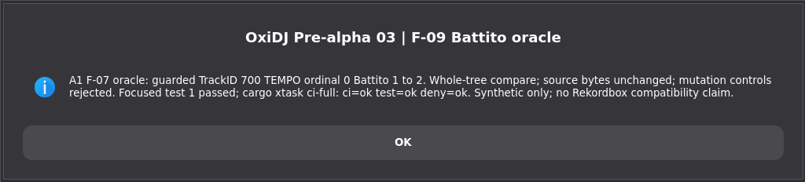

# v0.2 — Guarded Rekordbox XML edits begin: POSITION_MARK Start/End/Name and TEMPO Battito/Metro/Inizio.

Date: 2026-10-28 · Evidence commits: `364977d..680e7a2` · Raw evidence: [`pre-alpha-02`](../archive/pre-alpha-02/), [`pre-alpha-03`](../archive/pre-alpha-03/), [`pre-alpha-04`](../archive/pre-alpha-04/), [`pre-alpha-05`](../archive/pre-alpha-05/)

## What changed for the user

- CLI export can change one cue/tempo value only when the exact old value matches (fail-closed guard), writing a new file and leaving the source untouched.
- Each edit is checked by an independent whole-tree XML oracle with mutation controls.

## Key screenshots

Focused F-09 oracle run for the guarded POSITION_MARK Start edit (terminal capture). Source: [`archive/pre-alpha-02/01-position-mark-start-oracle.png`](../archive/pre-alpha-02/01-position-mark-start-oracle.png).

Evidence card: guarded TEMPO Battito edit, gate result. Source: [`archive/pre-alpha-03/01-battito-oracle.png`](../archive/pre-alpha-03/01-battito-oracle.png).

## Provenance and gates

Mixed Bot Screen terminal captures and Chromium-rendered evidence cards summarising synthetic test runs — not app UI. Synthetic-only; no Rekordbox compatibility claim. Gate results (`cargo xtask ci`/`ci-full`) and test names for each change are recorded in the archived READMEs and the commit bodies. Nothing here is Rekordbox/OneLibrary compatibility, accessibility, platform or performance qualification evidence.

[← Timeline](../README.md)
