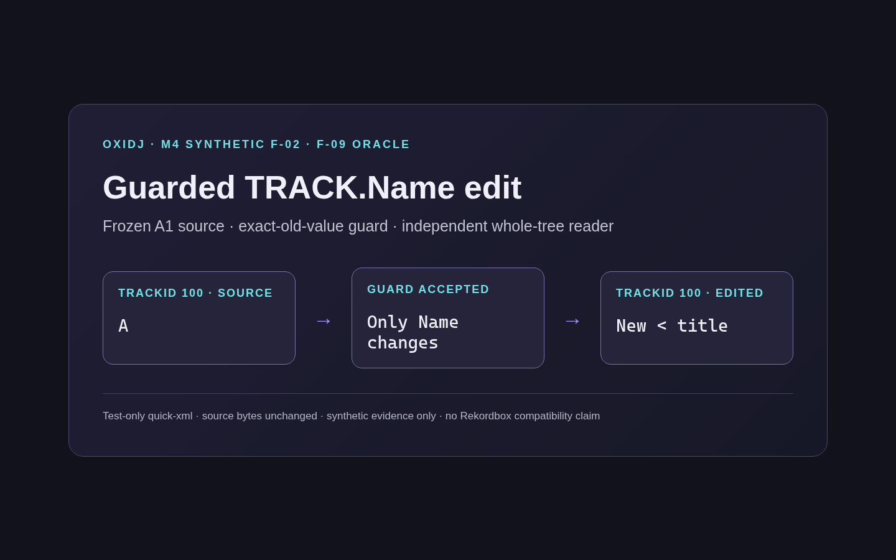
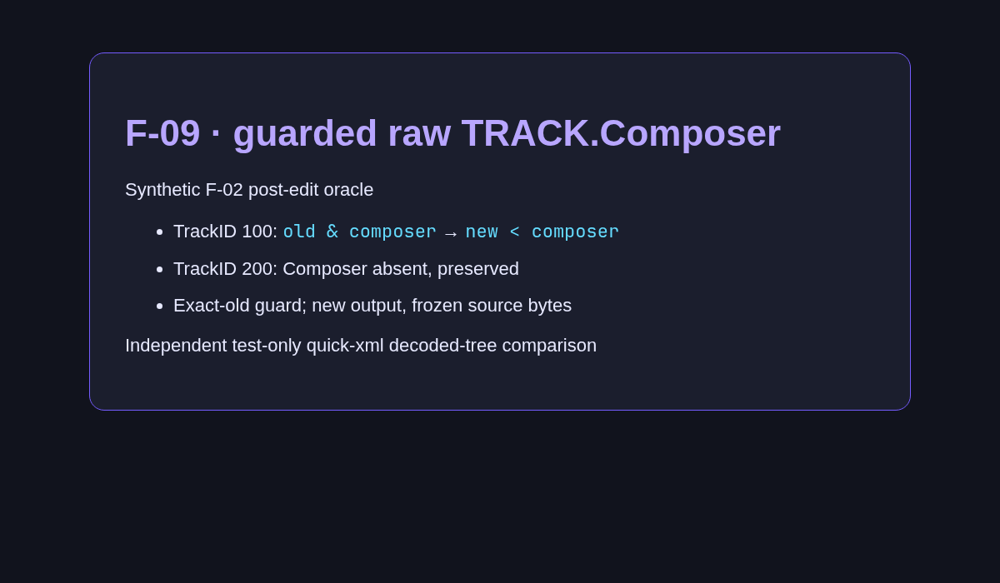

# v0.3 — Guarded edits for twelve TRACK text fields (Name, Artist, Album, Genre, Comments, …, Year).

Date: 2026-10-28 · Evidence commits: `16bbd98..44228d7` · Raw evidence: [`pre-alpha-06`](../archive/pre-alpha-06/), [`pre-alpha-07`](../archive/pre-alpha-07/), [`pre-alpha-08`](../archive/pre-alpha-08/), [`pre-alpha-09`](../archive/pre-alpha-09/), [`pre-alpha-10`](../archive/pre-alpha-10/), [`pre-alpha-11`](../archive/pre-alpha-11/), [`pre-alpha-12`](../archive/pre-alpha-12/), [`pre-alpha-13`](../archive/pre-alpha-13/), [`pre-alpha-14`](../archive/pre-alpha-14/), [`pre-alpha-15`](../archive/pre-alpha-15/), [`pre-alpha-16`](../archive/pre-alpha-16/), [`pre-alpha-17`](../archive/pre-alpha-17/)

## What changed for the user

- Name, Artist, Comments, Album, Genre, Label, Tonality, Composer, Grouping, Remixer, Mix and Year can each be edited with an exact-old-value guard; XML entities survive.

## Key screenshots

Evidence card: guarded TRACK.Name edit `A` → `New < title`. Source: [`archive/pre-alpha-06/01-track-name-oracle.png`](../archive/pre-alpha-06/01-track-name-oracle.png).

Evidence card: guarded raw TRACK.Composer edit. Source: [`archive/pre-alpha-13/01-composer-edit.png`](../archive/pre-alpha-13/01-composer-edit.png).

## Provenance and gates

Chromium-rendered evidence cards of synthetic F-02 oracle runs — not app UI. Gate results (`cargo xtask ci`/`ci-full`) and test names for each change are recorded in the archived READMEs and the commit bodies. Nothing here is Rekordbox/OneLibrary compatibility, accessibility, platform or performance qualification evidence.

[← Timeline](../README.md)
