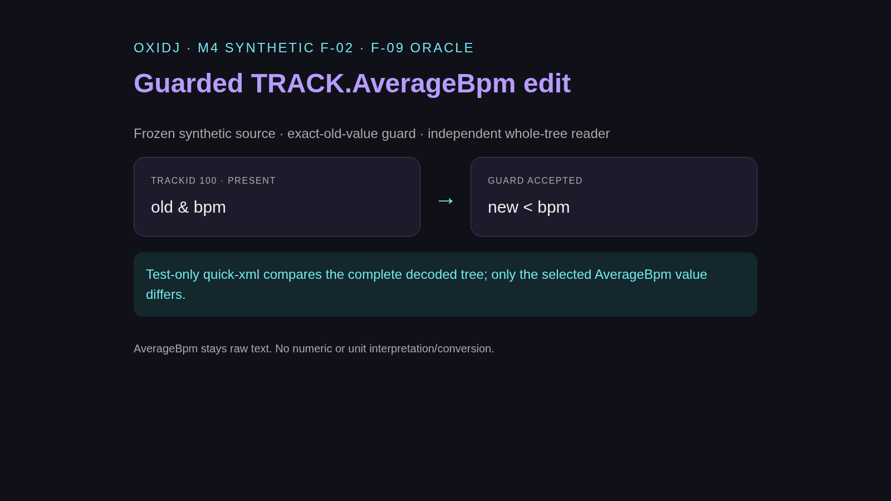
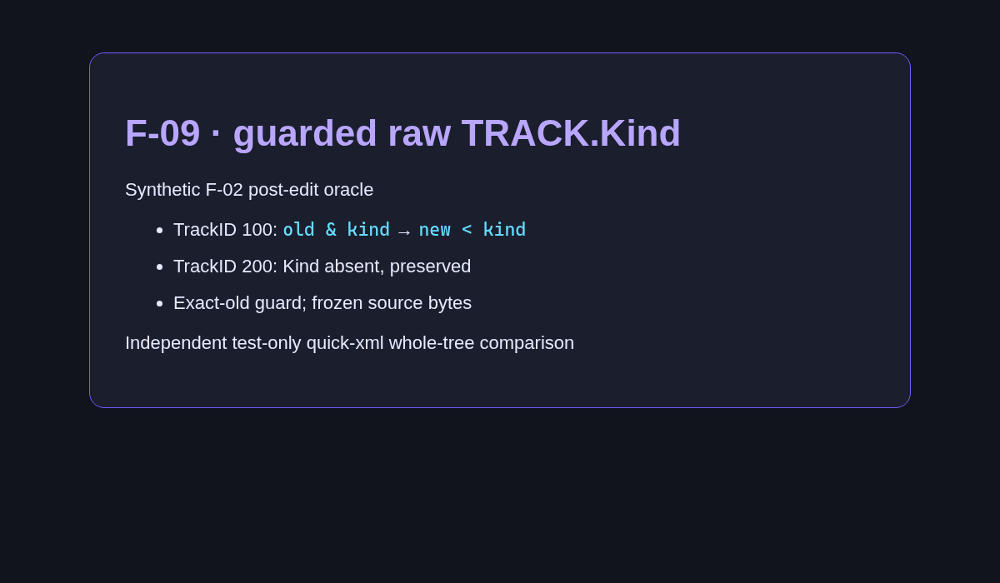

# v0.4 — Guarded raw edits for numeric/date TRACK attributes (Kind, Rating, Colour, dates, BPM, sizes, rates).

Date: 2026-10-28 · Evidence commits: `f1d322f..626f2b6` · Raw evidence: [`pre-alpha-18`](../archive/pre-alpha-18/), [`pre-alpha-19`](../archive/pre-alpha-19/), [`pre-alpha-20`](../archive/pre-alpha-20/), [`pre-alpha-21`](../archive/pre-alpha-21/), [`pre-alpha-22`](../archive/pre-alpha-22/), [`pre-alpha-23`](../archive/pre-alpha-23/), [`pre-alpha-24`](../archive/pre-alpha-24/), [`pre-alpha-25`](../archive/pre-alpha-25/), [`pre-alpha-26`](../archive/pre-alpha-26/), [`pre-alpha-27`](../archive/pre-alpha-27/), [`pre-alpha-28`](../archive/pre-alpha-28/), [`pre-alpha-29`](../archive/pre-alpha-29/), [`pre-alpha-30`](../archive/pre-alpha-30/), [`pre-alpha-31`](../archive/pre-alpha-31/)

## What changed for the user

- Kind, Rating, Colour, DateAdded, DateModified, LastPlayed, PlayCount, AverageBpm, DiscNumber, TrackNumber, Size, TotalTime, BitRate, SampleRate are edited as raw text (no unit conversion) behind the same guard.

## Key screenshots

Evidence card: guarded raw AverageBpm edit, kept as raw text. Source: [`archive/pre-alpha-25/01-average-bpm-edit-oracle.png`](../archive/pre-alpha-25/01-average-bpm-edit-oracle.png).

Evidence card: guarded raw TRACK.Kind edit. Source: [`archive/pre-alpha-18/01-kind-edit-oracle.png`](../archive/pre-alpha-18/01-kind-edit-oracle.png).

## Provenance and gates

Chromium-rendered evidence cards (pre-alpha-21 kept HTML only) — not app UI. Gate results (`cargo xtask ci`/`ci-full`) and test names for each change are recorded in the archived READMEs and the commit bodies. Nothing here is Rekordbox/OneLibrary compatibility, accessibility, platform or performance qualification evidence.

[← Timeline](../README.md)
