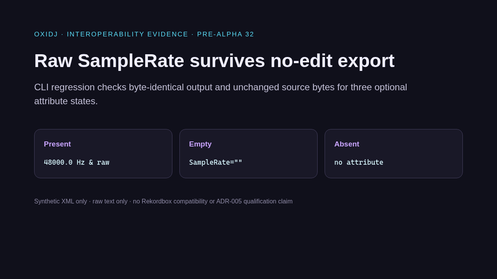
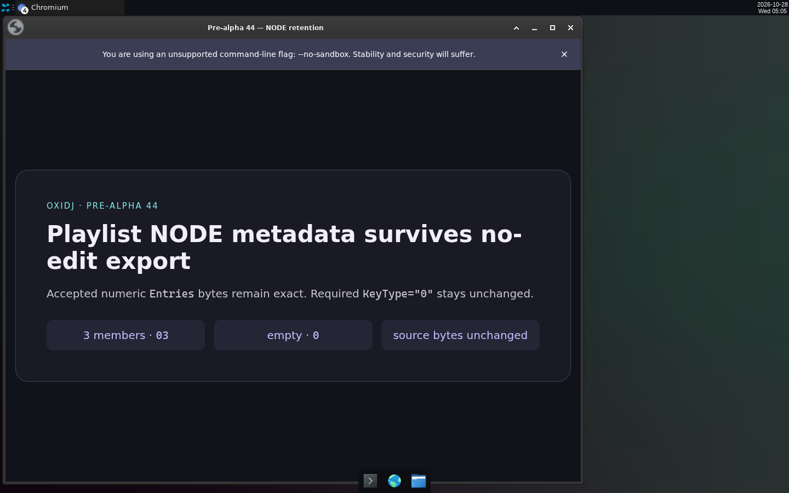

# v0.5 — No-edit export is byte-faithful: raw TRACK attributes and playlist NODE bytes survive present/empty/absent.

Date: 2026-10-28 · Evidence commits: `58bfc3a..d561cc8` · Raw evidence: [`pre-alpha-32`](../archive/pre-alpha-32/), [`pre-alpha-33`](../archive/pre-alpha-33/), [`pre-alpha-34`](../archive/pre-alpha-34/), [`pre-alpha-35`](../archive/pre-alpha-35/), [`pre-alpha-36`](../archive/pre-alpha-36/), [`pre-alpha-37`](../archive/pre-alpha-37/), [`pre-alpha-38`](../archive/pre-alpha-38/), [`pre-alpha-39`](../archive/pre-alpha-39/), [`pre-alpha-40`](../archive/pre-alpha-40/), [`pre-alpha-41`](../archive/pre-alpha-41/), [`pre-alpha-42`](../archive/pre-alpha-42/), [`pre-alpha-43`](../archive/pre-alpha-43/), [`pre-alpha-44`](../archive/pre-alpha-44/), [`pre-alpha-45`](../archive/pre-alpha-45/), [`pre-alpha-46`](../archive/pre-alpha-46/), [`pre-alpha-47`](../archive/pre-alpha-47/)

## What changed for the user

- Exporting without edits reproduces every covered attribute exactly, including empty and absent states and odd spellings, and preserves playlist NODE metadata.

## Key screenshots

Evidence card: raw SampleRate present/empty/absent survives no-edit export. Source: [`archive/pre-alpha-32/01-sample-rate-no-edit.png`](../archive/pre-alpha-32/01-sample-rate-no-edit.png).

Evidence card (in Chromium): playlist NODE `Entries`/`KeyType` bytes retained. Source: [`archive/pre-alpha-44/01-node-attribute-retention.png`](../archive/pre-alpha-44/01-node-attribute-retention.png).

## Provenance and gates

Chromium-rendered evidence cards of synthetic CLI regressions — not app UI. Gate results (`cargo xtask ci`/`ci-full`) and test names for each change are recorded in the archived READMEs and the commit bodies. Nothing here is Rekordbox/OneLibrary compatibility, accessibility, platform or performance qualification evidence.

[← Timeline](../README.md)
