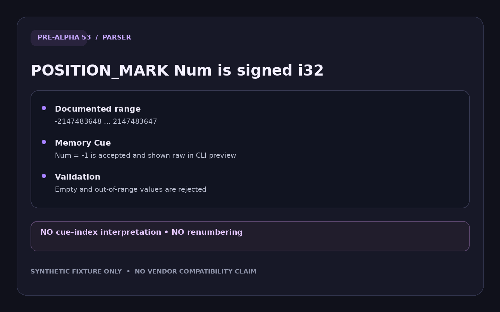
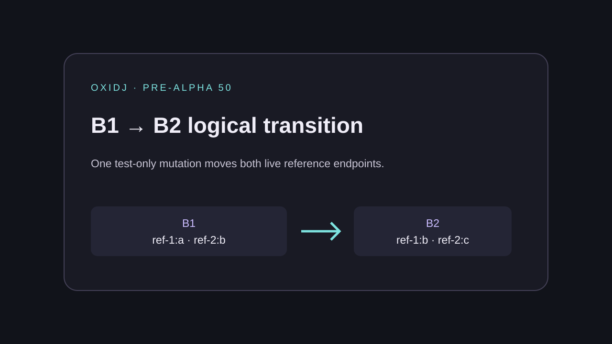

# v0.6 — Cue/tempo parsing boundaries: optional End, signed Num, Battito range — plus the B1→B2 reference transition.

Date: 2026-10-28 · Evidence commits: `dd2364e..459387d` · Raw evidence: [`pre-alpha-48`](../archive/pre-alpha-48/), [`pre-alpha-49`](../archive/pre-alpha-49/), [`pre-alpha-50`](../archive/pre-alpha-50/), [`pre-alpha-51`](../archive/pre-alpha-51/), [`pre-alpha-52`](../archive/pre-alpha-52/), [`pre-alpha-53`](../archive/pre-alpha-53/), [`pre-alpha-54`](../archive/pre-alpha-54/), [`pre-alpha-55`](../archive/pre-alpha-55/)

## What changed for the user

- Preview/export fail closed on empty `End`/`Num`, accept signed `Num`, validate `Battito` against `Metro`, and keep the raw bytes on no-edit export.
- Test-only ADR-005 oracle for a two-reference B1→B2 transition.

## Key screenshots

Evidence card: POSITION_MARK Num is a signed i32; `-1` accepted and shown raw. Source: [`archive/pre-alpha-53/01-signed-num-preview.png`](../archive/pre-alpha-53/01-signed-num-preview.png).

Evidence card: test-only ADR-005 B1→B2 logical reference transition. Source: [`archive/pre-alpha-50/01-b1-to-b2-transition.png`](../archive/pre-alpha-50/01-b1-to-b2-transition.png).

## Provenance and gates

Synthetic evidence cards — not app UI. pre-alpha-51 holds two designed illustration cards (not runtime captures). Gate results (`cargo xtask ci`/`ci-full`) and test names for each change are recorded in the archived READMEs and the commit bodies. Nothing here is Rekordbox/OneLibrary compatibility, accessibility, platform or performance qualification evidence.

[← Timeline](../README.md)
