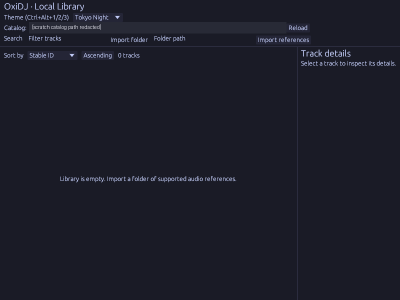
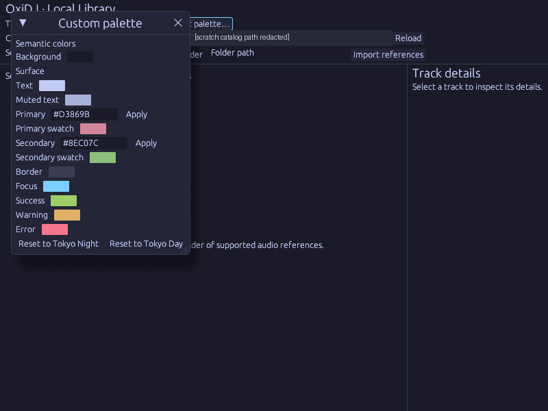

# v0.7 — Themes: Tokyo Night, Tokyo Day and an editable Custom palette that survives relaunch.

Date: 2026-10-30 · Evidence commits: `fe4f672..03636b5` · Raw evidence: [`pre-alpha-56`](../archive/pre-alpha-56/), [`pre-alpha-57`](../archive/pre-alpha-57/)

## What changed for the user

- Theme selector (Ctrl+Alt+1/2/3) and a Custom palette editor; Custom values persist across relaunch. Tokyo Day contrast was fixed (`54bb3d3`).

## Key screenshots

Tokyo Night, empty library. Source: [`archive/pre-alpha-56/tokyo-night.png`](../archive/pre-alpha-56/tokyo-night.png).

Custom palette editor after editing Primary/Secondary. Source: [`archive/pre-alpha-56/custom-edited.png`](../archive/pre-alpha-56/custom-edited.png).

## Provenance and gates

Genuine 800×600 Bot Screen captures against an empty scratch catalog. **The copies here are redacted**: the catalog-path text (a scratch path containing the local username) is covered by a box; the unredacted originals stay in the archive. Gate results (`cargo xtask ci`/`ci-full`) and test names for each change are recorded in the archived READMEs and the commit bodies. Nothing here is Rekordbox/OneLibrary compatibility, accessibility, platform or performance qualification evidence.

[← Timeline](../README.md)
