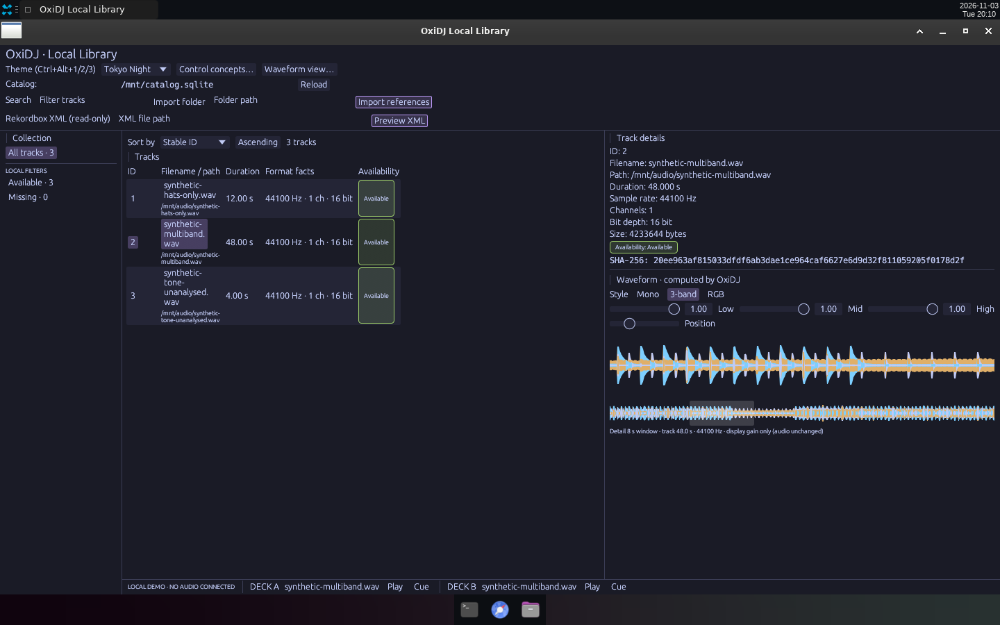
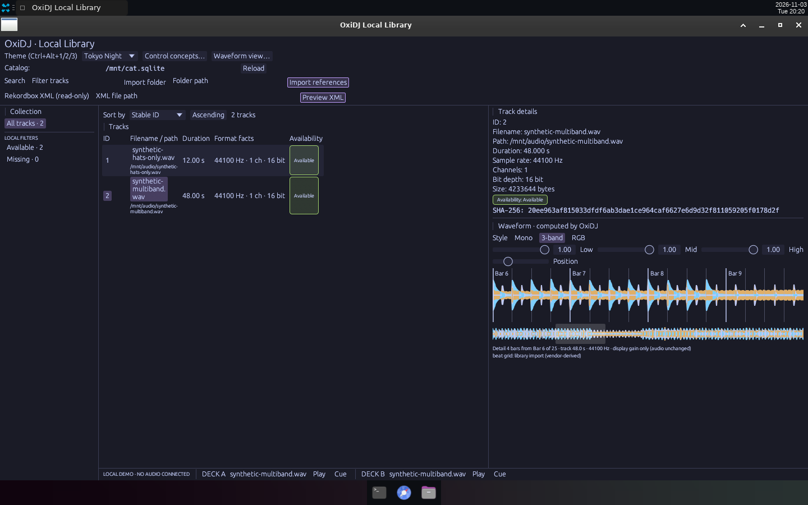

# v0.8 — Waveforms: computed peaks in Mono/3-band/RGB, smooth anti-aliased envelopes, bar-aware detail window from the imported beat grid.

Date: 2026-11-03 · Evidence commits: `107f656..e768ed1` · Raw evidence: [`waveform`](../archive/waveform/)

## What changed for the user

- W4: details panel draws OxiDJ-computed peaks (Mono, 3-band, RGB) with display-only band gains and a "not analysed" empty state.
- W5b: smooth triangle-strip envelopes. W6: bar/beat lines and a "Bar N" counter from the imported library beat grid.

## Key screenshots

W5b: 3-band waveform with the anti-aliased strip renderer. Source: [`archive/waveform/06-three-band-smooth.png`](../archive/waveform/06-three-band-smooth.png).

W6: 4-bar detail window with Bar N lines from the imported grid. Source: [`archive/waveform/08-beat-grid-three-band.png`](../archive/waveform/08-beat-grid-three-band.png).

## Provenance and gates

Real Bot Screen captures (1440×900) of release builds; synthetic audio from `gen_synthetic.py`, scratch data bind-mounted at `/mnt`. Gate results (`cargo xtask ci`/`ci-full`) and test names for each change are recorded in the archived READMEs and the commit bodies. Nothing here is Rekordbox/OneLibrary compatibility, accessibility, platform or performance qualification evidence.

[← Timeline](../README.md)
