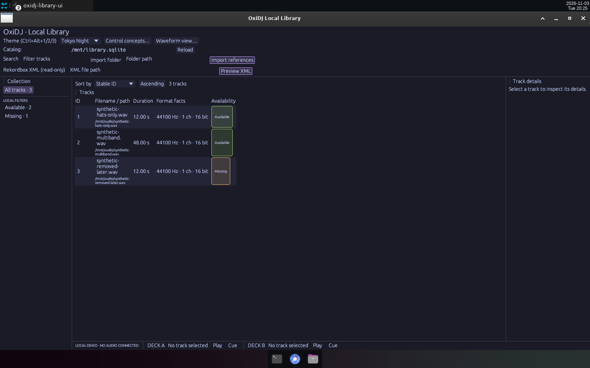
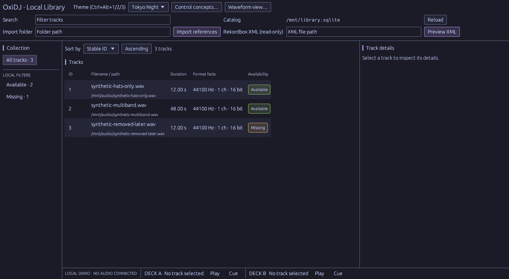
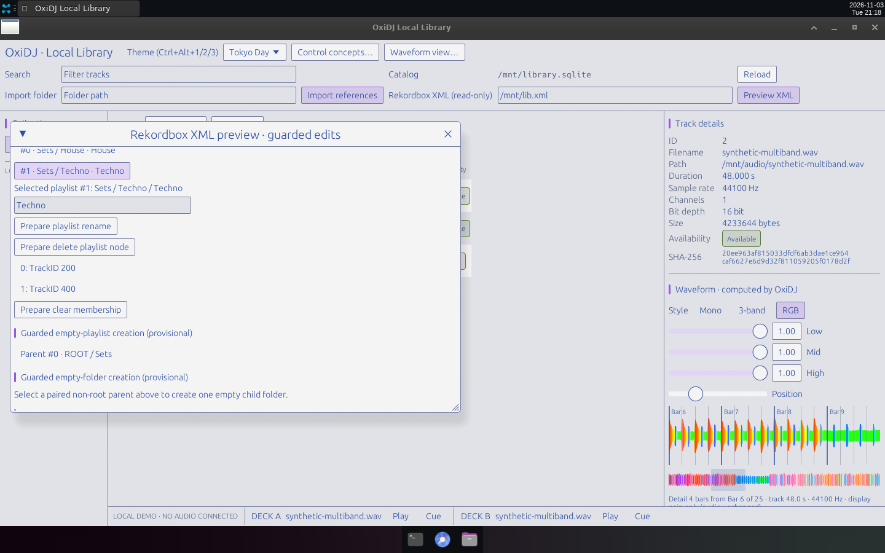

# v0.9 — Design audit W7: outlines, contrast, 24 px targets, type scale, stable table and details panel, scrollable XML window.

Date: 2026-11-03 · Evidence commits: `0f49c89..31ed107` · Raw evidence: [`ui-design-audit`](../archive/ui-design-audit/)

## What changed for the user

- 29 audit findings fixed in three rounds (see the archived README table): WCAG-checked border/selection tokens, 24 px controls, 11.5/14/20 px type scale, filename column that grows instead of wrapping, stable-width details panel, focus ring, 900 px layout.
- The XML preview window (guarded field edits and playlist/folder operations, added between v0.7 and v0.9 without their own capture dirs) now scrolls.

## Key screenshots

**Before** (`e768ed1`): borderless fields, table wrapping filenames, badges stretched. Source: [`archive/ui-design-audit/before/01-populated-1440.png`](../archive/ui-design-audit/before/01-populated-1440.png).

**After** (round 2, `69c2083`): aligned toolbar grid, outlined fields, readable table. Source: [`archive/ui-design-audit/after/04-populated-1440.png`](../archive/ui-design-audit/after/04-populated-1440.png).

After round 3: scrollable XML window with guarded playlist rename/delete/membership and folder creation (Tokyo Day). Source: [`archive/ui-design-audit/after-r3/04-xml-scrolled-member-reorder.png`](../archive/ui-design-audit/after-r3/04-xml-scrolled-member-reorder.png).

## Provenance and gates

Real Bot Screen captures of release builds, synthetic audio and the synthetic F-02 playlist fixture; scratch data at `/mnt`. Gate results (`cargo xtask ci`/`ci-full`) and test names for each change are recorded in the archived READMEs and the commit bodies. Nothing here is Rekordbox/OneLibrary compatibility, accessibility, platform or performance qualification evidence.

[← Timeline](../README.md)
