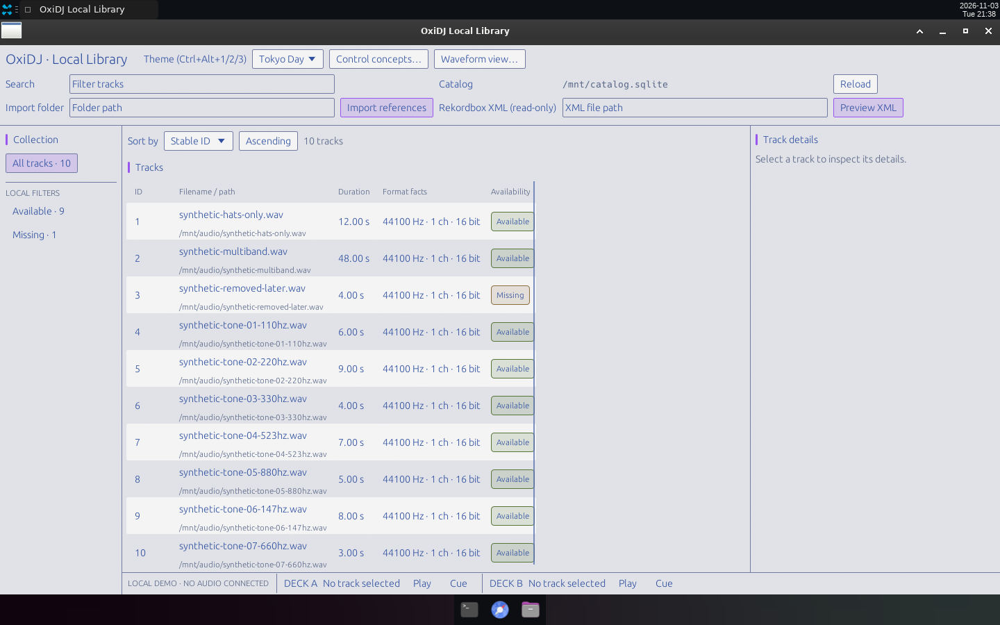
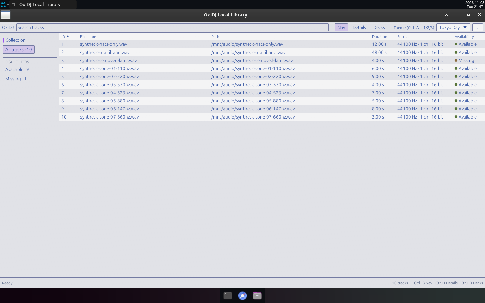
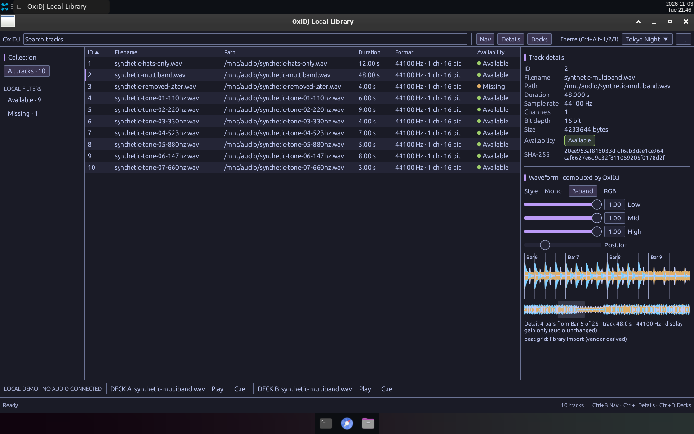

# v0.10 — Dense minimal shell W8: one-row toolbar, full-width sortable track table, toggleable Nav/Details/Decks panels.

Date: 2026-11-03 · Evidence commits: `91144a4` · Raw evidence: [`ui-minimal`](../archive/ui-minimal/)

## What changed for the user

- Catalog/import/XML controls move into a `…` popup; Nav (Ctrl+B), Details (Ctrl+I) and Decks (Ctrl+D) toggle; the table spans the window with a sortable header and a separate Path column.

## Key screenshots

**Before** (W7, `31ed107`, Tokyo Day): 4-row toolbar, two-line rows, fixed panels. Source: [`archive/ui-minimal/before/01-default-day-1440.png`](../archive/ui-minimal/before/01-default-day-1440.png).

**After** (W8, Tokyo Day defaults): 32 px toolbar, 24 px rows, full-width table, status bar. Source: [`archive/ui-minimal/after/06-tokyo-day-default-1440.png`](../archive/ui-minimal/after/06-tokyo-day-default-1440.png).

After, Tokyo Night: Nav + Details + Decks toggled on, track 2 selected. Source: [`archive/ui-minimal/after/02-all-panels-on-1440.png`](../archive/ui-minimal/after/02-all-panels-on-1440.png).

## Provenance and gates

Real Bot Screen captures (1440×900) of release builds, synthetic catalog of ten generated WAVs at `/mnt/audio`. Gate results (`cargo xtask ci`/`ci-full`) and test names for each change are recorded in the archived READMEs and the commit bodies. Nothing here is Rekordbox/OneLibrary compatibility, accessibility, platform or performance qualification evidence.

[← Timeline](../README.md)
