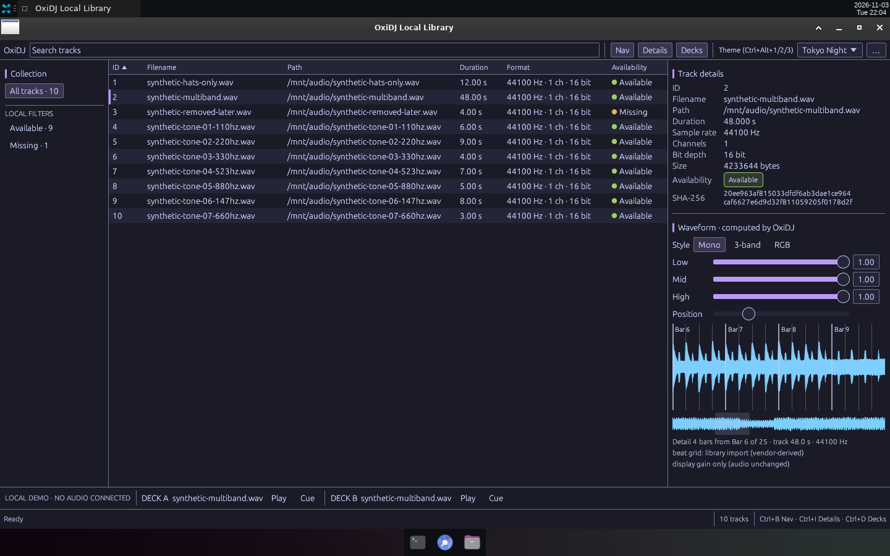
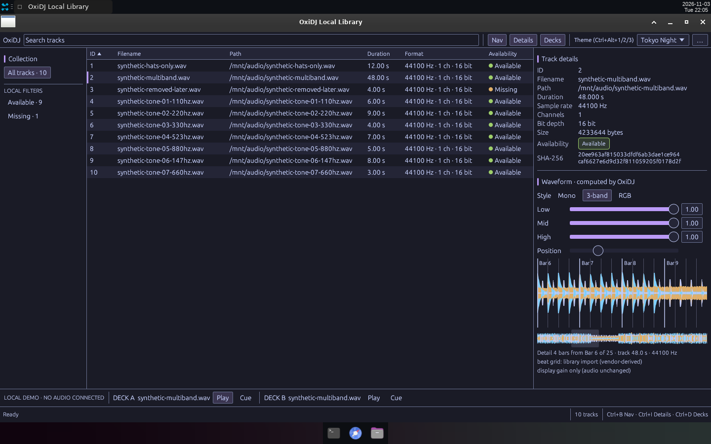

# v0.11 — W9 polish: aligned waveform slider rows, taller detail strip, stable decks bar.

Date: 2026-11-03 · Evidence commits: `89cd073` · Raw evidence: [`ui-minimal/after-w9`](../archive/ui-minimal/after-w9/)

## What changed for the user

- Waveform gain sliders share one label column and rail width; the detail strip uses spare height; Play no longer widens and shifts the decks bar; long deck names truncate.
- These two captures were the source of the public site screenshots until S2 (2026-11-04); the site now crops `v12-ui-polish` and `v13-computed-beat-grid` (`site/public/images/README.md`).

## Key screenshots

Details + Decks, Mono: one label column, aligned rails, 140 px detail strip. Source: [`archive/ui-minimal/after-w9/01-details-decks-mono-night-1440.png`](../archive/ui-minimal/after-w9/01-details-decks-mono-night-1440.png).

3-band, Deck A Play on: Play keeps its width, so Cue and Deck B stay put. Source: [`archive/ui-minimal/after-w9/02-three-band-deck-a-play-night-1440.png`](../archive/ui-minimal/after-w9/02-three-band-deck-a-play-night-1440.png).

## Provenance and gates

Real Bot Screen captures of the release build of the final W9 tree, same synthetic catalog as v0.10. Gate results (`cargo xtask ci`/`ci-full`) and test names for each change are recorded in the archived READMEs and the commit bodies. Nothing here is Rekordbox/OneLibrary compatibility, accessibility, platform or performance qualification evidence.

[← Timeline](../README.md)
